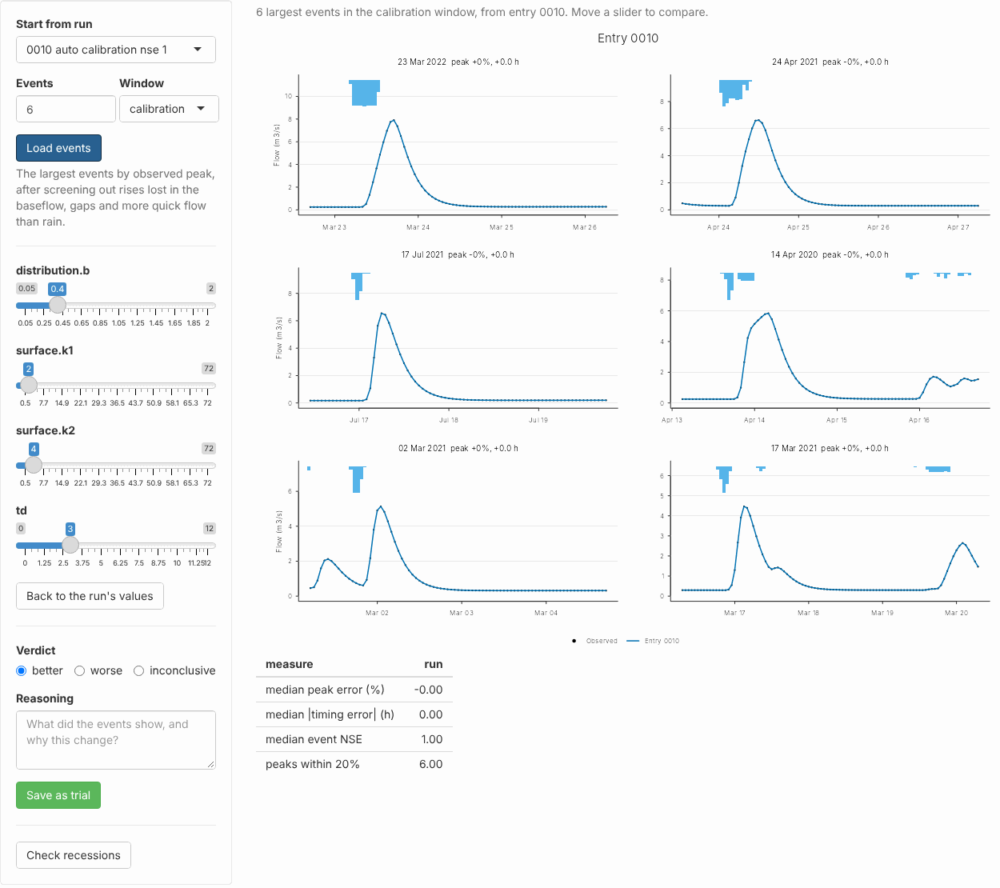

# Tailoring calibration to the largest events in the app

A model can score well over a whole record and still get the floods
wrong. NSE weighs time steps, not events: the long recessions between
storms outweigh the few hours around each peak, so a calibration can buy
a good score with peaks that are low and early. For flood forecasting
those few hours are the point.

The Events tab of
[`calibration_app()`](https://jonpayneea.github.io/PDMS7/reference/calibration_app.md)
puts the largest floods of the record on screen, next to sliders for the
parameters that shape them. Move a slider and the floods redraw at once.
When you have a setting you believe, you save it to the project log as a
trial, with your verdict and your reasons, and carry on from there:
refit the rest, propose a candidate, validate it, sign it off. Every
step is written to the log, so a reviewer later sees what you changed,
what it did, and why.

This guide follows one project through that path, with screenshots of
each step.

| Step         | Tab      | What you do                                                          |
|--------------|----------|----------------------------------------------------------------------|
| 1\. Look     | Events   | Load the largest events of the latest run and read the errors        |
| 2\. Adjust   | Events   | Move the surface stores and the time delay until the peaks sit right |
| 3\. Record   | Events   | Save the setting as a trial, with a verdict and reasons              |
| 4\. Check    | Events   | Check that the recessions still match                                |
| 5\. Refit    | Trial    | Refit the other parameters, starting from the trial                  |
| 6\. Confirm  | Events   | Load the events again from the refitted run                          |
| 7\. Propose  | History  | Compare the runs, propose the candidate and validate it              |
| 8\. Sign off | Sign-off | Final test, report and sign-off, as for any candidate                |

## The project

The project here is a synthetic catchment of 25 km², four years of
hourly rain and flow, made with
[`synthetic_rain()`](https://jonpayneea.github.io/PDMS7/reference/synthetic_rain.md)
and the standard model. Its fast response is a cascade of two stores of
2 and 4 hours, after a delay of 3 hours. Because the record is
synthetic, the true parameters are known, and you can see whether a
change moves towards them.

[`calibrate_project()`](https://jonpayneea.github.io/PDMS7/reference/calibrate_project.md)
calibrated it in three stages, starting from the standard preset with no
delay. The result scores well: NSE 0.90 over the calibration window,
0.89 in validation. Most calibrators would stop there.

To open the app on a project:

``` r
library(pdmS7)
options(pdmS7.user = "A Hydrologist", pdmS7.role = "custodian")
shiny::runApp(calibration_app("demo-brook"))
```

Click **Open project**, then the **Events** tab.

## 1. Look at the largest events

On the left, **Start from run** picks the run to examine; it starts on
the latest. **Events** sets how many to show, largest observed peak
first, and **Window** where their peaks must lie: in the calibration
years, the validation years, or anywhere. **Load events** finds them.

The events are found with
[`find_events()`](https://jonpayneea.github.io/PDMS7/reference/find_events.md)
and then screened with
[`screen_events()`](https://jonpayneea.github.io/PDMS7/reference/screen_events.md),
which drops rises too small to stand out from the baseflow, events
broken by gaps in the flow, and events that shed more quick flow than
their rain could supply. A flood that the rain gauges missed would
otherwise pull the calibration towards nonsense.


The six largest events in the calibration window, from the last stage of
the automatic calibration. Dots: observed flow. Blue: the run. Bars: the
rain.

Each panel title gives the date of the peak, the peak error and the
timing error. A negative peak error is a peak too low; a negative timing
error is a peak too early. The table beneath gives the medians over all
the events.

The picture is plain. Every peak is low, by 10% to 30%, and every peak
comes 1 to 2 hours early. The rise starts too soon and climbs too
slowly. Only three of the six peaks are within 20%. Look at the sliders
and the reason is there too: the time delay `td` is 0, and both surface
stores have drifted to about 4.9 hours. With no delay, the model must
start rising as soon as the rain falls; slow stores then hold the peak
back to roughly the right time and flatten it on the way. Over the whole
record that compromise costs little. On the floods it is wrong.

**How many events?** Six to ten is a good start: enough that one odd
storm cannot steer you, few enough to read every panel. Use the
calibration window to adjust. Use the validation window to look, never
to adjust: an event you tuned on can no longer test the model.

## 2. Adjust the sliders

The sliders cover the parameters that shape a flood: the surface stores
(`surface.k1` and `surface.k2` here), the store shape `b` where the
structure has one, and the time delay `td`. Each runs over its
calibration bounds; `td` runs from 0 to 12 hours. A slider starts at the
run’s value, rounded to its step. That rounding alone does not count as
a change.

Moving a slider reruns the events and draws the new flow in orange
beside the old.


The same events with surface stores of 2 and 4 hours and a 3 hour delay.
Orange: the trial.

With the stores at 2 and 4 hours and a delay of 3, every peak is on
time, the median event NSE rises from 0.86 to 0.97, and all six peaks
are within 20%. The panel titles give the change for each event: the 23
March 2022 flood goes from 19% low and 2 hours early to 15% high and on
time.

The peaks now overshoot by about 13%. That is expected, and it is not a
reason to back off the stores. The other parameters, the soil store and
the recharge, were fitted around the slow stores; change the stores
alone and the rest is out of step. Step 5 fixes that.

**Why it is quick.** The tab runs the record once, when the events load,
and saves the state of every store just before each event. A change to
the surface stores or the delay reruns only the events, each from its
saved state, which takes a fraction of a second. A change to `b` reaches
the soil store, so the state before every event changes; the tab then
reruns the whole record and says so above the plots. **Back to the run’s
values** resets every slider.

## 3. Record the trial

When the floods look right, say so. Choose a **Verdict**, write your
**Reasoning**, and click **Save as trial**.


The verdict and the reasons, ready to save.

The trial is written to the project log exactly as a trial on the Trial
tab is: its parent run, each parameter with its old and new value, the
scores over the whole calibration window, your verdict and your
reasoning, and your name and role from the bar at the top. Only the
sliders you moved are recorded. Here the whole-window NSE rises from
0.90 to 0.98: the change that fixed the floods improved the record as a
whole.

Write the reasons for a reader who was not there. “Faster stores and a 3
h delay put all six peaks on time” says what you saw; “peaks now 13%
high: refit the rest” says what comes next.

## 4. Check the recessions

Faster stores change how the river empties after each flood. **Check
recessions** runs
[`recession_analysis()`](https://jonpayneea.github.io/PDMS7/reference/recession_analysis.md)
on the observed flow and on the model with the sliders as they stand,
and draws both.


How fast the flow falls against how high it is, from dry spells:
observed in black, the trial in blue.

The two clouds and their fitted slopes lie together, 0.59 observed
against 0.57 modelled, so the trial has not spoiled the recessions. If
the blue points had fallen away from the black, the stores would be
draining the river too fast or too slowly between storms, whatever the
peaks showed. Do not read the slope itself as the type of groundwater
store; [Getting the floods
right](https://jonpayneea.github.io/PDMS7/articles/floods.html#recessions-how-the-river-empties)
explains why.

## 5. Refit the rest

On the **Trial** tab, set **Start from run** to the trial, 0009. Under
**Automatic calibration**, choose the parameters to refit: here the soil
store’s `fc`, `distribution.cmax` and `distribution.b`, and the recharge
`recharge.kg`. Leave the surface stores and the delay out, so the search
keeps what you set by eye.


A refit of the volume and recharge parameters, starting from the trial.

**Bounds** sets how far each parameter may move, as a fraction of its
value: 0.5 lets each move by half either way. **Starts** runs the search
from several points and keeps the best. **Run and log calibration**
writes the result to the log as a new run whose parent is the trial.

## 6. Confirm on the events

Back on the Events tab, load the events again, this time from the
refitted run, 0010.



The six events from the refitted run.

The peaks are on time and the right size. This is synthetic data, made
with the same model, so the refit lands on the true parameters exactly
and every score reaches 1. A real record will not be so obliging: expect
the peaks to improve, not to vanish into the observations, and expect to
go round steps 2 to 6 more than once.

## 7. Compare, propose and validate

The **History** tab shows every run in the order logged, with its score,
and the table of trials beneath, with the changes and the reasons.


The path of the calibration: the structure (square), the automatic
stages (triangles), the trial saved from the Events tab (dot, a better
verdict), and the refit. The candidate is ringed.

Below the table, **Compare** draws two runs over the whole record with
their scores side by side. Comparing the trial with the refit shows the
overshoot gone: KGE’s variability term falls from 1.14 back to 1.

Then propose the run as the candidate, with the reasons, and run the
validation.


The refitted run proposed as the candidate and validated.

Validation scores the candidate on years it was never fitted to. If the
peaks hold up there, the change was real, not a fit to six storms.

## 8. Test and sign off

From here the candidate goes the same way as any other: the final test
on the held-back years, if any were registered, then the report and the
sign-off on the **Report** and **Sign-off** tabs. The report shows the
trial and its reasons in the calibration path. A steward reading it sees
that the automatic calibration left the floods low and early, that a
hydrologist moved the stores and the delay, why, and what the change did
to every score.

## The same in code

Everything on the Events tab is a function you can call yourself:

``` r
wb <- event_workbench("demo-brook", "0006", n = 6)
faster <- workbench_try(wb, c(surface.k1 = 2, surface.k2 = 4, td = 3))
plot_workbench(wb, faster)
faster$scores
log_trial("demo-brook", "0006", c(surface.k1 = 2, surface.k2 = 4, td = 3), "better",
          "Faster stores and a 3 h delay put all six peaks on time. Peaks now 13% high.")
```

## The app or the events stage?

The automatic calibration can do much of this itself.
`pdm_stages(config, events = TRUE)` adds a fourth stage that refits the
surface stores, `b` and the delay on the largest events, scored on event
NSE, peak error and timing error ([Automatic calibration from start to
finish](https://jonpayneea.github.io/PDMS7/articles/calibration-journey.md)).
Run that first. The Events tab is for what a search cannot do: look at
the floods, judge whether a change is right for the reasons you think,
notice an event the rain gauges got wrong, and write down why. Use it
after the events stage, to check it, or instead of it when a forecaster
needs to see and own the choice.

## Pitfalls

- **Tuning on too few events.** Six storms can share a season and a
  cause. Before you save, try twice as many and see if the change still
  helps.
- **Tuning on the validation years.** Look at them, but adjust on the
  calibration window only.
- **Chasing a bad event.** If one flood will not fit whatever you do,
  check its rain and its flow before you blame the model. [Checking the
  data and the
  events](https://jonpayneea.github.io/PDMS7/articles/checks.md) shows
  how.
- **Saving without reasons.** A trial with no reasoning tells a reviewer
  nothing. The log keeps the numbers; only you can give the why.
- **Stopping at the trial.** A trial changes a few parameters by hand.
  Refit the rest around it before you propose it.

## Where to go next

- [Getting the floods
  right](https://jonpayneea.github.io/PDMS7/articles/floods.md): why
  whole-record scores miss the floods, and the event tools behind this
  tab.
- [Checking the data and the
  events](https://jonpayneea.github.io/PDMS7/articles/checks.md): checks
  to run before trusting any event.
- [Calibration
  records](https://jonpayneea.github.io/PDMS7/articles/calibration-log.md):
  what each entry records, and the rest of the app.
- [Calibrating a catchment from start to
  finish](https://jonpayneea.github.io/PDMS7/articles/calibration-journey.md):
  the stages, including the events stage.
