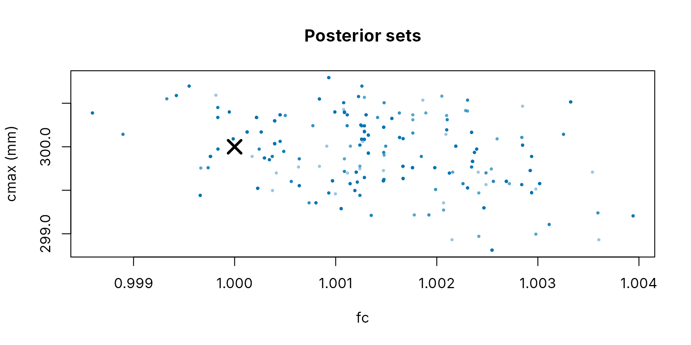
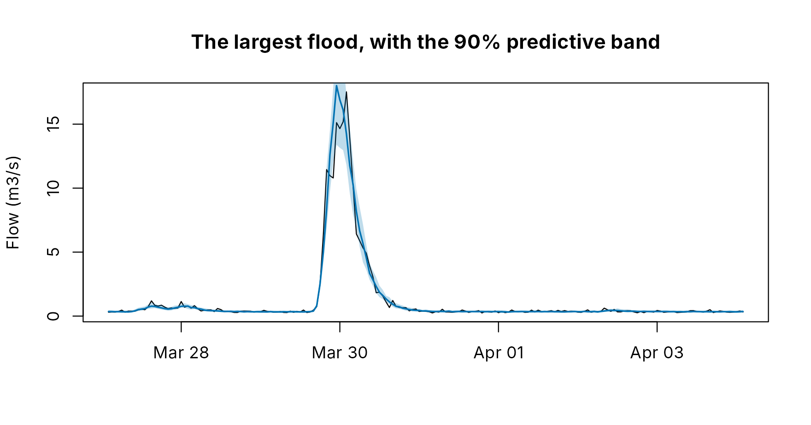

# How sure are we? Bayesian calibration

An ordinary calibration returns one set of parameters, the best it
found. It says nothing about the other sets that fit nearly as well, or
about how far the forecast might be from the truth because of them.
Bayesian calibration returns all of them: a sample of every set
consistent with the record and with what was known before, each in
proportion to how well it fits. The spread of the sample is the
uncertainty of the parameters; running its sets gives a band round the
forecast.

## The idea in three parts

1.  **The prior** is what was known before looking at the record: that
    `cmax` is likely to be around 250 mm, say, give or take 30%. It may
    come from experience, from a regional study, or from a model of
    parameters from catchment descriptors.
2.  **The likelihood** is how probable the observed flows are if a given
    set is right. It needs a model of the errors.
3.  **The posterior** combines the two: sets that fit the record well
    and are plausible beforehand. Where the record pins a parameter
    down, the record wins; where it cannot, the prior keeps the
    parameter sensible instead of letting it drift to a bound.

## The error model

The likelihood treats the errors on Box-Cox flows ([Counting every error
fairly](https://jonpayneea.github.io/PDMS7/articles/fair-errors.md)) as
running on from one hour to the next: this hour’s error is a share `rho`
of the last hour’s plus a fresh error. Hourly errors do run on, because
a model that is too low at the start of a recession stays too low for
hours. Treating them as independent would count each hour as new
evidence and make the posterior far too sure of itself. `rho` and the
size of the fresh errors are set to their best values for each set.

## The sampler

The posterior cannot be written down; it is sampled.
[`calibrate_bayes()`](https://jonpayneea.github.io/PDMS7/reference/calibrate_bayes.md)
uses DREAM(ZS) (ter Braak and Vrugt, 2008; Vrugt, 2016). Several chains
wander through the parameter space. Each step proposes a jump built from
the difference between two past positions, kept in an archive, and
accepts it more readily the better it fits. Built that way, the jumps
take the shape of the posterior itself, which suits the long, curved
ridges of hydrological models and needs no tuning. The first half of
every chain is discarded as burn-in.

## An example

The synthetic catchment of the other articles, with a prior on `fc`
centred on the truth and a uniform prior, over its bounds, on `cmax`:

``` r
rain <- synthetic_rain("2017-10-01", years = 3, dt = 1, seed = 5)
truth <- modifyList(pdm_presets("standard"), list(area_km2 = 25))
model <- pdm_from_config(truth)
forcing <- rain[c("time", "rain", "pet")]
set.seed(8)
flow <- run_pdm(model, forcing[c("rain", "pet")], initial_state(model, 0.5))$output$q_m3s
observed <- flow * exp(rnorm(length(flow), 0, 0.15))
```

``` r
post <- calibrate_bayes(truth, forcing, observed, lower = c(fc = 0.6, distribution.cmax = 100),
                        upper = c(fc = 1.4, distribution.cmax = 500),
                        priors = list(fc = prior_normal(1, 0.3)), generations = 800,
                        lambda = 0, warmup = 24 * 90, start = "soil", seed = 3)
post
#> Bayesian calibration: 3 chains x 800 generations, 2420 model runs, acceptance 12%; 1200 posterior sets
#>          parameter    mean        sd      q05     q50     q95  rhat
#>                 fc   1.001 0.0009737   0.9998   1.001   1.003 1.079
#>  distribution.cmax 299.943 0.3949744 299.2891 299.974 300.515 1.007
```

Each parameter has its mean, spread and 5%, 50% and 95% points. `rhat`
compares the chains: under about 1.2 for every parameter they have found
the same posterior; above it, run more generations. The power of the
Box-Cox transform is 0 here because these errors are proportional to the
flow.

The posterior is narrow: three years of hourly flow pin `fc` down to
within a fraction of a per cent. That is honest about the parameters,
given this model and this rain. It says nothing about errors in the rain
itself, which calibrating on the rainfall used operationally deals with.
Where the posterior is still too sure, `temper` below 1 counts the
record as worth less: 0.25 treats it as a quarter of its length.

## Seeing the posterior

The sample is a table of sets; its columns can be plotted like any data.

``` r
plot(post$samples$fc, post$samples$distribution.cmax, pch = 16, cex = 0.5,
     col = grDevices::adjustcolor("#0072B2", 0.4), xlab = "fc", ylab = "cmax (mm)",
     main = "Posterior sets")
points(1, 300, pch = 4, cex = 2, lwd = 3)
```



The cross is the truth. A tilted cloud would show the two parameters
trading off against each other, a ridge of equally good sets; a round
one, that the record determines each on its own.

## A predictive band

[`posterior_band()`](https://jonpayneea.github.io/PDMS7/reference/posterior_band.md)
runs sets drawn from the posterior. Without the error model the band
shows the parameters’ uncertainty alone; with it, the band is where the
observed flow should fall.

``` r
band <- posterior_band(post, forcing, draws = 50, noise = TRUE)
rows <- which.max(observed) + seq(-72, 120)
plot(forcing$time[rows], observed[rows], type = "l", xlab = "", ylab = "Flow (m3/s)",
     main = "The largest flood, with the 90% predictive band")
polygon(c(forcing$time[rows], rev(forcing$time[rows])), c(band$q05[rows], rev(band$q95[rows])),
        col = grDevices::adjustcolor("#0072B2", 0.25), border = NA)
lines(forcing$time[rows], band$q50[rows], col = "#0072B2", lwd = 1.5)
```



``` r
covered <- mean(observed >= band$q05 & observed <= band$q95, na.rm = TRUE)
cat(sprintf("Share of hours inside the 90%% band: %.0f%%\n", 100 * covered))
#> Share of hours inside the 90% band: 87%
```

A 90% band should hold about 90% of the observations. Far fewer means
the band is too narrow, the error model too optimistic; far more, too
cautious. [Is a probability forecast
honest?](https://jonpayneea.github.io/PDMS7/articles/ensemble-verification.md)
checks this properly.

## Priors from catchment descriptors

A model of parameters from catchment descriptors, trained on many
catchments, predicts each parameter of a new catchment with a spread.
[`priors_from_table()`](https://jonpayneea.github.io/PDMS7/reference/priors_from_table.md)
turns its predictions into priors:

``` r
predicted <- data.frame(parameter = c("distribution.cmax", "fc"),
                        median = c(280, NA), sdlog = c(0.25, NA),
                        mean = c(NA, 1.05), sd = c(NA, 0.1))
priors_from_table(predicted, widen = 1.5)
#> $distribution.cmax
#> $distribution.cmax$type
#> [1] "lognormal"
#> 
#> $distribution.cmax$meanlog
#> [1] 5.63479
#> 
#> $distribution.cmax$sdlog
#> [1] 0.375
#> 
#> 
#> $fc
#> $fc$type
#> [1] "normal"
#> 
#> $fc$mean
#> [1] 1.05
#> 
#> $fc$sd
#> [1] 0.15
```

`widen` stretches every spread, to allow for the catchment being one the
model has not seen. With priors like these, a short record calibrates
far better than it could alone, and an ungauged catchment can still be
modelled, from the priors only.

## Cautions

- **Check `rhat` every time.** A run that has not converged gives a
  sample of the wrong thing.
- **The posterior is only as good as the error model.** Choose the
  Box-Cox power so the errors are the same size at every flow, and check
  the band’s coverage.
- **It costs thousands of runs**: chains times generations. On long
  15-minute records, a coarser step for a first look, or a shorter
  record, keeps it practical.
