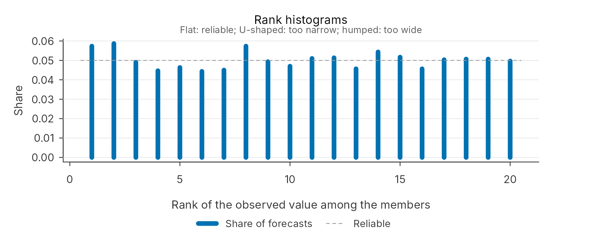
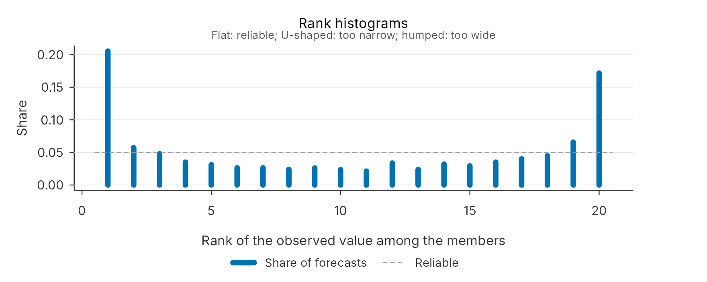
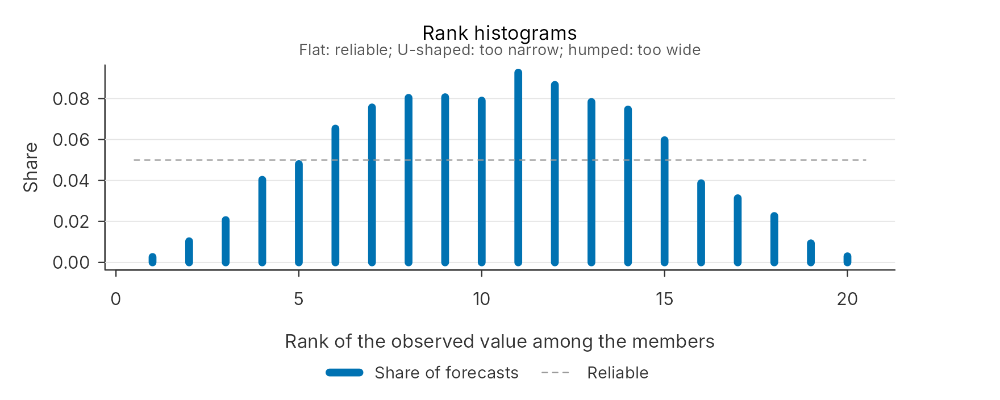
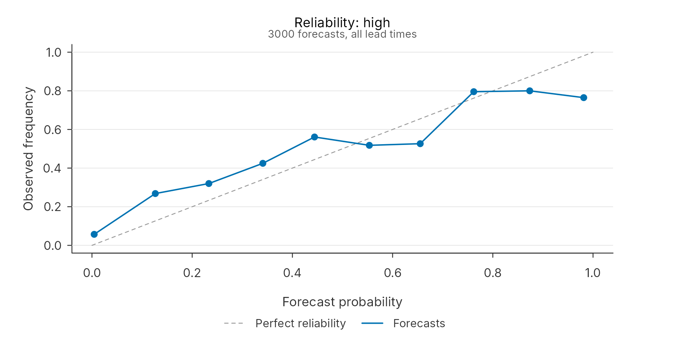

# Is a probability forecast honest? Ensemble verification

An ensemble forecast gives many possible futures; from them comes a
probability, such as a 30% chance of the river crossing its warning
threshold. That is only useful if it is honest: of all the times it says
30%, the river should cross about 30% of the time. A forecast that says
30% when the truth is 60% misleads the duty officer as surely as a wrong
number. This article covers the scores that check it, first on ensembles
whose honesty is known, then on a model’s.

## The CRPS: the whole forecast against what happened

The continuous ranked probability score compares the whole spread of the
ensemble with the observed value. For members X and X’ and observation
y:

$$\text{CRPS} = \overline{|X - y|} - \frac{1}{2}\,\overline{|X - X\prime|}$$

The first term rewards members close to what happened; the second
credits the ensemble for admitting uncertainty, so a wide ensemble is
not punished merely for being wide. It is in the units of the flow, 0 is
perfect, and for a single member it is the absolute error.

``` r
crps_ensemble(matrix(c(0, 1), nrow = 1), 0)               # members 0 and 1, observed 0
#> [1] 0.25
crps_ensemble(matrix(c(0, 1), nrow = 1), 0, fair = TRUE)
#> [1] 0
```

With members 0 and 1 and the river at 0: the members are on average 0.5
away, and on average 0.5 apart over all four ordered pairs, so the CRPS
is 0.5 - 0.25 = 0.25. The fair form (Ferro, 2014) averages the second
term over distinct pairs only, which removes a penalty small ensembles
otherwise carry.

## The Brier score: thresholds

For a threshold, the forecast probability is the share of members above
it. The Brier score is the mean squared difference between that
probability and what happened (1 if the river crossed, 0 if not).
Murphy’s decomposition splits it into three parts:

- **reliability**: how far each forecast probability lies from how often
  the event then happened; lower is better;
- **resolution**: how far those frequencies differ from the event’s
  overall frequency; higher is better, since a forecast that always says
  the average resolves nothing;
- **uncertainty**: the variance of the event itself, which no forecast
  can change.

``` r
b <- brier_score(c(0.9, 0.9, 0.1, 0.1), c(1, 0, 0, 0))
unlist(b[c("brier", "reliability", "resolution", "uncertainty")])
#>       brier reliability  resolution uncertainty 
#>      0.2100      0.0850      0.0625      0.1875
```

Two forecasts of 90%, of which one came true, and two of 10%, of which
none did: the 90% was too high (it happened half the time) and the 10%
too high as well (it never happened). The score of 0.21 is exactly the
reliability, 0.085, less the resolution, 0.0625, plus the uncertainty,
0.1875.

## Too narrow, too wide or right

Three ensembles of the same truth, with a known answer. The truth
scatters about a centre with a spread of 1. A reliable ensemble scatters
its members about the same centre by the same amount; a narrow one by
half as much; a wide one by twice as much.

``` r
set.seed(3)
n <- 3000
centre <- rnorm(n)
truth <- centre + rnorm(n)
members <- function(s) centre + s * matrix(rnorm(n * 19), n, 19)
high <- c(high = 1.5)
scores <- rbind(right = ensemble_scores(members(1), truth, thresholds = high),
                narrow = ensemble_scores(members(0.5), truth, thresholds = high),
                wide = ensemble_scores(members(2), truth, thresholds = high))
scores[, c("crps", "spread_skill", "brier:high", "reliability:high")]
#>             crps spread_skill brier:high reliability:high
#> right  0.5962121    1.0016848 0.08568698      0.001500991
#> narrow 0.6308894    0.5082156 0.08925023      0.006132617
#> wide   0.7220011    1.8501440 0.11006464      0.016031395
```

`spread_skill` is the ensemble’s spread over the error of its mean,
adjusted for the number of members. Near 1 the ensemble is as wide as
its errors; the narrow one, at about a half, claims far more certainty
than it has; the wide one, at about two, too little. The CRPS and the
Brier score are best for the right one.

## Rank histograms

For each forecast, sort the members and see where the observed value
falls among them: below all of them (rank 1), between the first and
second, and so on to above all of them. For an honest ensemble the
observation is equally likely to fall anywhere, and the histogram of
ranks is flat.

``` r
plot(ensemble_scores(members(1), truth), type = "rank")
```



``` r
plot(ensemble_scores(members(0.5), truth), type = "rank")
```



``` r
plot(ensemble_scores(members(2), truth), type = "rank")
```



Flat: honest. U-shaped: the observation keeps falling outside the
ensemble, which is too narrow. Humped: it keeps falling in the middle,
and the ensemble is too wide. A slope means the ensemble is biased high
or low.

## Reliability diagrams

For a threshold, group the forecasts by their probability and plot how
often the event happened in each group against the probability forecast.

``` r
plot(ensemble_scores(members(0.5), truth, thresholds = high), type = "reliability")
```



Points on the diagonal are honest. The narrow ensemble’s points lie
flatter than the diagonal: when it says 90% the event happens less
often, and when it says 10%, more often. It is overconfident in both
directions.

## By lead time

A forecast’s honesty changes with the lead. Give
[`ensemble_scores()`](https://jonpayneea.github.io/PDMS7/reference/ensemble_scores.md)
each forecast’s lead time and it scores each lead apart, with a rank
histogram for each; `plot(type = "crps")` draws the CRPS, the error of
the ensemble mean and the spread against the lead. Where the spread
falls below the error, the ensemble has become overconfident.

``` r
s <- ensemble_scores(ensemble, observed, lead_h = forecasts$lead_h,
                     thresholds = c(warning = 45))
plot(s, type = "crps")
```

## A model’s ensemble

The Bayesian calibration of [How sure are
we?](https://jonpayneea.github.io/PDMS7/articles/bayesian-calibration.md)
gives an ensemble of model runs. Run as it is, it shows the parameters’
uncertainty only; with the error model added, it should be an honest
forecast of the observed flow.

``` r
rain <- synthetic_rain("2017-10-01", years = 3, dt = 1, seed = 5)
truth_cfg <- modifyList(pdm_presets("standard"), list(area_km2 = 25))
model <- pdm_from_config(truth_cfg)
forcing <- rain[c("time", "rain", "pet")]
set.seed(8)
flow <- run_pdm(model, forcing[c("rain", "pet")], initial_state(model, 0.5))$output$q_m3s
observed <- flow * exp(rnorm(length(flow), 0, 0.15))
post <- calibrate_bayes(truth_cfg, forcing, observed, lower = c(fc = 0.6, distribution.cmax = 100),
                        upper = c(fc = 1.4, distribution.cmax = 500),
                        priors = list(fc = prior_normal(1, 0.3)), generations = 800,
                        lambda = 0, warmup = 24 * 90, start = "soil", seed = 3)
every <- seq(24 * 90, nrow(forcing), by = 6)
runs <- function(noise) {
  vapply(1:20, function(i) {
    posterior_band(post, forcing, draws = 1, probs = 0.5, noise = noise, seed = i)$q50
  }, numeric(nrow(forcing)))[every, ]
}
flood <- c(high = unname(stats::quantile(observed, 0.98)))
rbind(parameters_only = ensemble_scores(runs(FALSE), observed[every], thresholds = flood),
      with_errors = ensemble_scores(runs(TRUE), observed[every], thresholds = flood))[
  , c("crps", "spread_skill", "brier:high")]
#>                       crps spread_skill  brier:high
#> parameters_only 0.05067232   0.01538814 0.003151579
#> with_errors     0.03752952   1.03126145 0.002490674
```

The parameters alone give an ensemble a small fraction of the width of
its errors: it would claim near certainty. With the error model its
spread matches its errors and its scores improve. The same model
calibrated with the Box-Cox power 0.5 instead of 0 gives a ratio near
0.6 here: on that scale the largest flows’ errors look smaller than they
are, so the ensemble is too narrow exactly where warnings are decided.
These checks are how to tell.

## Cautions

- **Score on forecasts made as they would be in service**: from regular
  origins, with the rain that would have been forecast, at the leads the
  service uses.
- **Small samples mislead.** A rank histogram of a few dozen forecasts
  is noise; flood thresholds are crossed rarely, so their Brier scores
  need many years.
- **Honest is not the same as useful.** An ensemble that always
  forecasts the climatology is honest and resolves nothing. Look at
  resolution and the CRPS as well as reliability.
