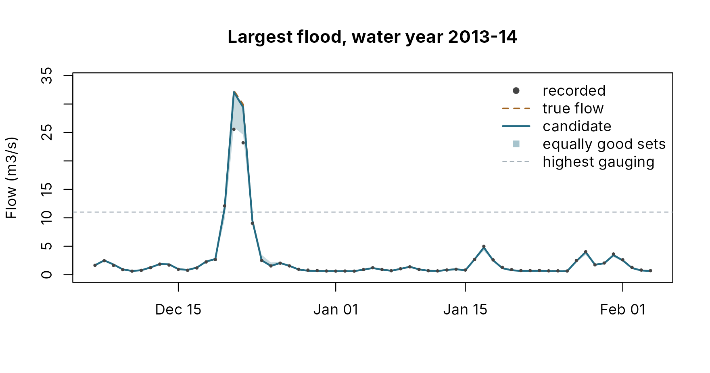

# Larger floods: extrapolation and the rating

A model calibrated on a river’s record is fitted to the floods in that
record. It is used for the floods that are not: the ones that matter
most. A calibration can score well on every window and still go wrong
once flows pass anything it was fitted to. Three things cause most of
the trouble.

- **Large floods are rare.** The parameters that control them, chiefly
  the soil store’s capacity and the fast routing, are barely tested by
  the record. Many settings fit it equally well and then disagree above
  it.
- **The optimiser uses every freedom it has.** A store that only fills
  in a big flood costs nothing to get wrong if no big flood occurs
  during calibration, so its fitted value is close to arbitrary.
- **The largest observed flows are themselves extrapolated.** Above the
  highest flow ever gauged, the rating curve is a line drawn beyond its
  data. The size of those flows is uncertain, even though their order is
  not.

No calibration method removes these. pdmS7 makes them visible, in the
record, before anyone signs off.

## What pdmS7 does

| Check                           | How                                                                                                                                                                                                          | When                                               |
|---------------------------------|--------------------------------------------------------------------------------------------------------------------------------------------------------------------------------------------------------------|----------------------------------------------------|
| **Wettest years held back**     | The two wettest water years (October to September) in the calibration and validation windows, ranked by their highest flow, are left out of every calibration, trial and validation score.                   | Chosen at registration; scored once, with the test |
| **Spread of equally good fits** | Each automatic calibration keeps the parameter sets it tried that score within a tolerance of its best (0.02 NSE by default), up to 50 spread-out sets. The test runs every one through the held-back years. | Kept at calibration; reported at the test          |
| **Rating flag**                 | Given the highest gauged flow, registration counts the flows above it in each window, and the test marks each held-back peak that lies above it.                                                             | Recorded at registration and test                  |

Holding back the largest floods is the differential split-sample test of
Klemeš (1986): fit on one kind of conditions, test on another. Ranking
years by their highest flow survives rating error, because a rating
rises with stage: it may get a flood’s size wrong, but not whether it
was bigger than another. The rating flag does not change the fit. It
tells the reviewer where the observed numbers deserve less trust.

## The example

[`synthetic_catchment()`](https://jonpayneea.github.io/PDMS7/reference/synthetic_catchment.md)
builds a river with a known answer: rain from a stochastic generator, a
PDM with chosen parameters, and a gauge that records the flow with
persistent error and an extrapolated rating. Here, ten water years of
daily data for a 60 km2 catchment, with two large storms added in
2013-14 and 2018-19. The station’s highest check gauging is 11 m3/s;
above it, the rating records flows low, by 15 per cent at twice that
flow.

``` r
river <- synthetic_catchment(
  years = 10, dt = 24, area_km2 = 60, seed = 21,
  storms = data.frame(time = c("2013-12-20", "2018-11-02"), depth_mm = c(130, 170),
                      duration_h = c(48, 72)),
  highest_gauged_m3s = 11
)
river
#> Synthetic catchment: 3650 steps of 24 h from 2010-10-01T00:00:00Z 
#>   Rain: nsrp - 807 mm a year; 2 added storms 
#>   True flow: mean 0.954 m3/s, peak 28.4 m3/s
#>   Gauge error: sd 0.05 in logs, memory 72 h
#>   Rating: exact to 11 m3/s, then 15 per cent low at twice that; 5 steps above
forcing <- river$forcing
observed <- river$observed
truth <- river$truth
years <- wettest_years(forcing$time, observed, n = 2)
years[, c("water_year", "start", "peak_m3s", "held")]
#>    water_year                start  peak_m3s  held
#> 1     2013-14 2013-10-01T00:00:00Z 22.703046  TRUE
#> 2     2018-19 2018-10-01T00:00:00Z 19.372790  TRUE
#> 3     2012-13 2012-10-01T00:00:00Z  7.664298 FALSE
#> 4     2019-20 2019-10-01T00:00:00Z  6.956333 FALSE
#> 5     2010-11 2010-10-01T00:00:00Z  6.373497 FALSE
#> 6     2011-12 2011-10-01T00:00:00Z  5.600537 FALSE
#> 7     2014-15 2014-10-01T00:00:00Z  5.264775 FALSE
#> 8     2017-18 2017-10-01T00:00:00Z  4.796519 FALSE
#> 9     2016-17 2016-10-01T00:00:00Z  4.508485 FALSE
#> 10    2015-16 2015-10-01T00:00:00Z  3.349098 FALSE
```

[`wettest_years()`](https://jonpayneea.github.io/PDMS7/reference/wettest_years.md)
is what
[`register_data()`](https://jonpayneea.github.io/PDMS7/reference/calibration_log.md)
uses. The two held-back years have recorded peaks of 23 and 19 m3/s; no
other year exceeds 8.

This is a best case. The true model is a PDM, so its structure is
exactly right; the rain is known exactly; and the gauge error is simpler
than a real one’s. A real catchment will do worse than anything shown
here.

## Registering the data

``` r
project <- file.path(tempdir(), "wet-brook")
unlink(project, recursive = TRUE)
start_calibration_project(project, catchment = "Wet Brook", gauge = "00001",
                          purpose = "Flood forecasting", area_km2 = 60,
                          owner = "Area Manager", steward = "Sam Steward")
#> INFO [2026-11-07 21:39:17] Started calibration project wet-brook in /tmp/Rtmp1d6oem/wet-brook
reg <- register_data(project, forcing, observed,
                     calibration = c("2011-01-01", "2016-09-30"),
                     validation = c("2016-10-01", "2019-09-30"),
                     test = c("2019-10-01", "2020-09-27"),
                     highest_gauged_m3s = river$highest_gauged_m3s,
                     reasoning = "Ten years; rating checked to 11 m3/s.")
#> INFO [2026-11-07 21:39:17] Registered data 0002: 3650 rows
check <- reg$rating_check$windows
data.frame(window = names(check), steps_above = sapply(check, `[[`, "steps_above"),
           highest_m3s = round(sapply(check, `[[`, "highest_m3s"), 1))
#>                  window steps_above highest_m3s
#> calibration calibration           0         7.7
#> validation   validation           0         4.8
#> test               test           0         7.0
#> wettest         wettest           5        22.7
```

The rating check, recorded in the entry, shows the problem at once.
Every flow above the gauged limit lies in the held-back years. Without
the hold-out, the calibration would have been fitted to 5 days of
extrapolated flow, and nothing in the record would have said so.

## Calibrating

An ordinary automatic calibration of every parameter, from the standard
starting point.

``` r
start <- pdm_presets("standard")
start$dt <- 24
start$area_km2 <- 60
select_structure(project, start, "Standard structure.")
#> INFO [2026-11-07 21:39:17] Structure 0003: nse 0.4081
b <- calibration_bounds(start)
fit <- log_auto_calibration(
  project, parent = 3, lower = setNames(b$lower, b$path), upper = setNames(b$upper, b$path),
  log_scale = b$path[b$scale == "log"], starts = 3, seed = 2, control = list(maxit = 40),
  reasoning = "All parameters, three starts."
)
#> Warning: A steady start at 1.702 m3/s with baseflow_fraction 0.70 needs 266.5
#> mm of soil storage, more than the store's capacity of 203 mm; the soil is
#> capped and the run starts out of balance. Start at a lower flow or a smaller
#> baseflow_fraction, or use start = "soil".
#> INFO [2026-11-07 21:39:34] Calibration 0004: nse 0.9927
good <- fit$equally_good
c(nse = fit$scores$nse, trials_within_tolerance = good$within, sets_kept = length(good$sets))
#>                     nse trials_within_tolerance               sets_kept 
#>               0.9927173            1080.0000000              50.0000000
```

The warning is the calibration’s own: the record opens at 1.7 m3/s, 1.8
times the average flow, and the calibrated model cannot hold 70 per cent
of that as steady baseflow, so its runs begin a little out of balance.
The three months of warm-up before the calibration window are there for
this.

The calibration NSE is 0.993. Of the parameter sets the search tried,
1080 scored within 0.02 of the best; 50 spread-out ones are kept. How
far apart are they?

``` r
sets <- do.call(rbind, lapply(good$sets, function(s) unlist(s$parameters)))
spread <- t(apply(sets, 2, range))
data.frame(truth = sapply(colnames(sets), function(p) pdmS7:::.path_get(truth, p)),
           calibrated = signif(sapply(colnames(sets), function(p) {
             pdmS7:::.path_get(fit$configuration, p)
           }), 3),
           lowest = signif(spread[, 1], 3), highest = signif(spread[, 2], 3))
#>                     truth calibrated   lowest highest
#> fc                    1.0      0.992    0.893    1.01
#> distribution.cmax   300.0    286.000  268.000  503.00
#> distribution.b        0.4      0.407    0.375    1.32
#> recharge.kg        4000.0   3730.000 2640.000 4250.00
#> surface.k1           12.0     12.000    3.580   20.70
#> surface.k2           12.0     12.000    4.890   24.10
#> groundwater.kb    10000.0   9990.000  285.000 9920.00
```

Fits that reproduce the calibration record almost equally well disagree
widely. The groundwater constant `kb` spans 285 to 9924, a factor of 35;
the soil capacity `cmax` spans 268 to 503 mm. The record cannot tell
them apart. These are the parameters the introduction warned of: barely
tested by ordinary years, and exactly the ones a large flood depends on.

## The test

Validation and the test follow the usual rules. The test also reveals
the held-back years.

``` r
propose_candidate(project, fit$id, "Best automatic fit.")
validation <- validate_candidate(project, "Validation holds up.")
#> INFO [2026-11-07 21:39:34] Validation 0006: nse 0.992
test <- test_candidate(project, "Final check, including the wettest years.")
#> INFO [2026-11-07 21:39:35] Test 0007: nse 0.9926
#> INFO [2026-11-07 21:39:35] Wettest years 0007: nse 0.9589
c(validation = validation$validation_scores$nse, test_window = test$test_scores$nse,
  wettest_years = test$wettest$scores$nse)
#>    validation   test_window wettest_years 
#>     0.9920390     0.9925939     0.9589164
peaks <- do.call(rbind, lapply(test$wettest$years, as.data.frame))
held <- reg$scorecard$wettest$years
peaks$true_peak_m3s <- sapply(held, function(y) max(river$true_flow[y$first_row:y$last_row]))
peaks[, -1] <- lapply(peaks[, -1], function(x) if (is.numeric(x)) round(x, 1) else x)
peaks
#>   water_year observed_peak_m3s simulated_peak_m3s spread_low_m3s
#> 1    2013-14              22.7               28.4           19.3
#> 2    2018-19              19.4               24.9           19.6
#>   spread_high_m3s above_gauged true_peak_m3s
#> 1            28.8         TRUE          28.4
#> 2            25.2         TRUE          24.3
```

The scores look respectable: NSE over the wettest years is 0.96, dragged
down by the peaks but propped up by the many ordinary days. The peaks
tell the real story, and here, unlike on a real river, the true peak is
known.

| Water year | Candidate against the recorded peak | Candidate against the true peak | Rating’s error at the peak | Width of the equally good range |
|------------|-------------------------------------|---------------------------------|----------------------------|---------------------------------|
| 2013-14    | +25%                                | +0%                             | 20% low                    | 33% of the true peak            |
| 2018-19    | +28%                                | +2%                             | 20% low                    | 23% of the true peak            |

Two lessons follow.

- **The recorded peak is not the truth.** Judged against the recorded
  peaks, the candidate overestimates by 25 and 28 per cent. Against the
  true peaks it is within 2 per cent. Both peaks lie above the highest
  gauging, and the extrapolated rating recorded them about 20 per cent
  low: the rating is wrong, not the model. On a real river the true peak
  is unknown, which is why the report flags such peaks rather than
  scoring them as fact. A modeller who “fixed” this apparent
  overestimate by recalibrating to the recorded peaks would make the
  model worse.
- **The calibration cannot pin the big floods down.** Equally good fits
  span 23 to 33 per cent of the true peak. The candidate landing near
  the truth is partly luck: another fit, scoring as well on the record,
  would have missed by more.

``` r
y <- held[[which.max(peaks$true_peak_m3s)]]
peak <- y$first_row - 1 + which.max(river$true_flow[y$first_row:y$last_row])
rows <- (peak - 15):(peak + 45)
simulate <- function(parameters) {
  cfg <- fit$configuration
  for (p in names(parameters)) cfg <- pdmS7:::.path_set(cfg, p, parameters[[p]])
  m <- pdm_from_config(cfg)
  # The same start as the calibration, and the same warning for every set, so it is hidden.
  start <- suppressWarnings(initial_state_from_flow(m, observed[1], 0.7))
  run_pdm(m, forcing[c("rain", "pet")], start)$output$q_m3s[rows]
}
ensemble <- sapply(good$sets, function(s) simulate(s$parameters))
candidate <- simulate(list())
time <- forcing$time[rows]
plot(time, observed[rows], type = "n", ylim = c(0, max(ensemble, river$true_flow[rows]) * 1.05),
     xlab = "", ylab = "Flow (m3/s)", main = paste("Largest flood, water year", y$water_year))
polygon(c(time, rev(time)), c(apply(ensemble, 1, min), rev(apply(ensemble, 1, max))),
        col = adjustcolor(pal[2], 0.25), border = NA)
abline(h = river$highest_gauged_m3s, lty = 2, col = pal[7])
lines(time, river$true_flow[rows], col = pal[3], lwd = 1.5, lty = 2)
lines(time, candidate, col = pal[2], lwd = 2)
points(time, observed[rows], pch = 16, cex = 0.5, col = pal[1])
legend("topright", c("recorded", "true flow", "candidate", "equally good sets",
                     "highest gauging"),
       col = c(pal[1], pal[3], pal[2], adjustcolor(pal[2], 0.4), pal[7]),
       pch = c(16, NA, NA, 15, NA), lty = c(NA, 2, 1, NA, 2), lwd = c(NA, 1.5, 2, NA, 1),
       bty = "n")
```



## Reading the result

The scores answer “does the model reproduce this river?”. The held-back
peaks answer the question a forecaster asks: “would it have got the big
one right?”. Read the table in three parts.

- **The candidate against the observed peak.** A large miss on floods
  the model never saw is the plainest sign that the calibration does not
  extrapolate, unless the rating flag says the observed peak is itself
  in doubt.
- **The width of the range.** A wide range means the record cannot pin
  down the parameters that control large floods. The candidate’s own
  peak is then partly luck, good or bad.
- **The rating flag.** Where the observed peak lies above the highest
  gauging, a miss may be the rating’s error rather than the model’s.
  Treat both as uncertain.

When the range is wide, more calibration effort will not help. The
remedies change what the calibration knows: fix the poorly constrained
parameter from independent evidence (soil data for `cmax`, or the
baseflow index for `kb`), choose a simpler structure that extrapolates
predictably (see [Choosing a model
structure](https://jonpayneea.github.io/PDMS7/articles/choosing-structure.md)),
or extend the rating with new gaugings. Record the decision, with its
reasons, in a note before sign-off.

## Settings

| Argument of [`register_data()`](https://jonpayneea.github.io/PDMS7/reference/calibration_log.md) | Default | Meaning                                                                                                   |
|--------------------------------------------------------------------------------------------------|---------|-----------------------------------------------------------------------------------------------------------|
| `wettest_years`                                                                                  | 2       | Years held back. Needs a `time` column and enough record to leave three years. 0 holds none back.         |
| `highest_gauged_m3s`                                                                             | none    | The top of the reliable rating. Flows above it are flagged, never changed.                                |
| `tie_tolerance`                                                                                  | 0.02    | How close to the best calibration score, in the headline’s units, a set must be to count as equally good. |

The test needs both the held-back years and a logged automatic
calibration to report a range. A manual trial, or a fit from a structure
comparison, keeps no record of the alternatives, so its range is the
candidate alone, and the report says so. Projects registered before
version 0.5.0 hold nothing back.

## Reference

Klemeš, V. (1986) Operational testing of hydrological simulation models.
*Hydrological Sciences Journal* 31(1), 13-24.
