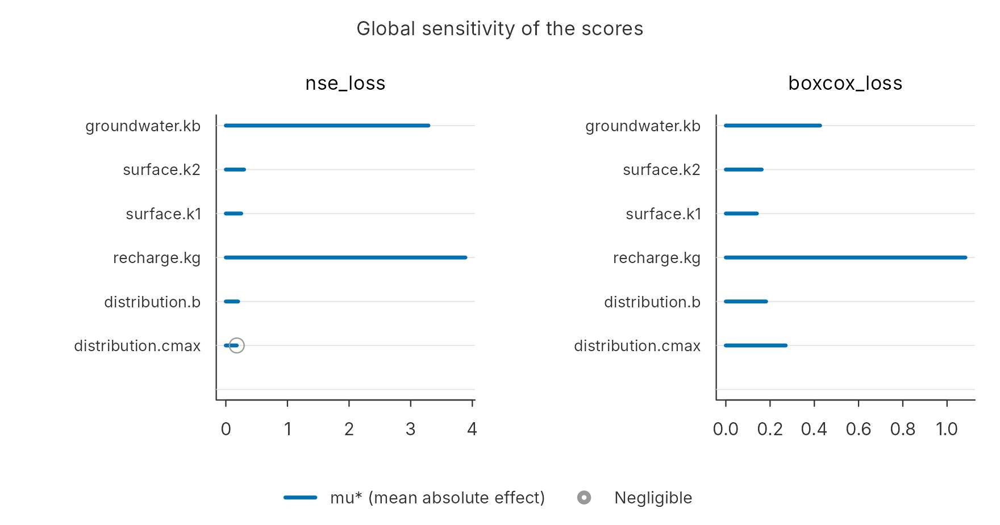
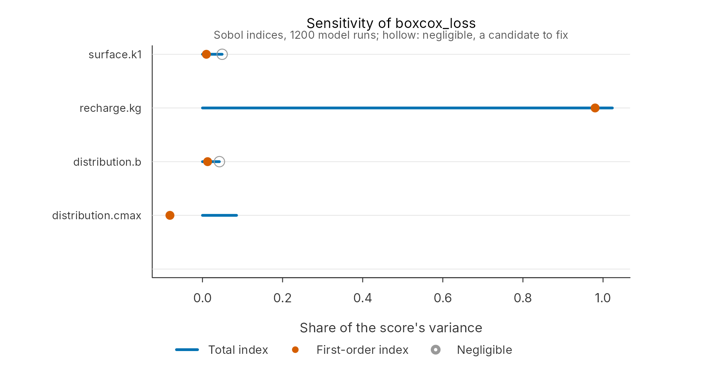

# Which parameters can the record determine? Global sensitivity

Calibrate the same catchment twice and get two different sets of
parameters with the same score: the commonest complaint about automatic
calibration. Usually the search is not at fault. The record simply does
not contain the information to fix some of the parameters: many values
fit equally well, and each search stops at a different one. A
sensitivity analysis finds those parameters before the calibration
wastes effort on them.

## Why one at a time is not enough

The usual check moves one parameter at a time from the calibrated set
and watches the score. That measures sensitivity at one point. A
parameter can look unimportant there only because of where the others
happen to sit: a slow groundwater store matters little if the recharge
feeding it is small. A global analysis moves every parameter across its
whole range, all together, and asks how much each one matters on average
and whether its effect depends on the others.

## A catchment and its bounds

The synthetic catchment of [Counting every error
fairly](https://jonpayneea.github.io/PDMS7/articles/fair-errors.md),
with the bounds
[`calibration_bounds()`](https://jonpayneea.github.io/PDMS7/reference/calibration_bounds.md)
gives the standard structure (it holds the rainfall factor `fc` fixed
unless asked otherwise):

``` r
rain <- synthetic_rain("2017-10-01", years = 3, dt = 1, seed = 5)
truth <- modifyList(pdm_presets("standard"), list(area_km2 = 25))
model <- pdm_from_config(truth)
forcing <- rain[c("time", "rain", "pet")]
set.seed(8)
flow <- run_pdm(model, forcing[c("rain", "pet")], initial_state(model, 0.5))$output$q_m3s
observed <- flow * exp(rnorm(length(flow), 0, 0.15))
b <- calibration_bounds(truth)
b[, c("path", "lower", "upper", "scale")]
#>                path lower   upper  scale
#> 1 distribution.cmax 2e+01     800 linear
#> 2    distribution.b 5e-02       2 linear
#> 3       recharge.kg 1e+00    5000    log
#> 4        surface.k1 5e-01      72    log
#> 5        surface.k2 5e-01      72    log
#> 6    groundwater.kb 1e+02 1000000    log
lower <- stats::setNames(b$lower, b$path)
upper <- stats::setNames(b$upper, b$path)
```

## Morris screening

Morris’s method walks random paths through the parameter space, changing
one parameter at a time by a fixed step, and records how much the score
moves each time: an *elementary effect*. Two numbers summarise each
parameter’s effects:

- `mu_star`, their mean size: how much the parameter matters;
- `sigma`, their spread: how much that depends on the others, through
  interactions or a curved response.

It costs `r` paths of (parameters + 1) runs each, a few hundred runs
here.

``` r
m <- pdm_sensitivity(truth, forcing, observed, lower, upper,
                     objectives = c("nse_loss", "boxcox_loss"), r = 15,
                     log_scale = b$path[b$scale == "log"], warmup = 24 * 90, start = "soil")
m
#> Global sensitivity (morris), 105 model runs
#>    objective         parameter mu_star      mu sigma negligible
#>     nse_loss distribution.cmax   0.178  0.1132 0.224       TRUE
#>     nse_loss    distribution.b   0.200 -0.1381 0.235      FALSE
#>     nse_loss       recharge.kg   3.888 -3.8326 5.154      FALSE
#>     nse_loss        surface.k1   0.251 -0.0124 0.553      FALSE
#>     nse_loss        surface.k2   0.296 -0.0730 0.600      FALSE
#>     nse_loss    groundwater.kb   3.288 -3.2121 5.554      FALSE
#>  boxcox_loss distribution.cmax   0.271  0.0657 0.369      FALSE
#>  boxcox_loss    distribution.b   0.182 -0.1257 0.220      FALSE
#>  boxcox_loss       recharge.kg   1.083 -0.9893 0.960      FALSE
#>  boxcox_loss        surface.k1   0.140  0.0661 0.217      FALSE
#>  boxcox_loss        surface.k2   0.162  0.0468 0.292      FALSE
#>  boxcox_loss    groundwater.kb   0.426 -0.3755 0.699      FALSE
#> Negligible for some objective: distribution.cmax
plot(m)
```



The effects are measured per unit of each parameter’s range, so they
compare directly. Read them in two steps. First, which parameters stand
out by `mu_star`. Second, which sit near zero: `negligible` marks those
under 5% of the largest. A large `sigma` beside a large `mu_star` means
the parameter’s effect depends on the others.

Here two parameters dwarf the rest: the recharge time constant
`recharge.kg` and the groundwater store `groundwater.kb`. Their ranges
are enormous (1 to 5,000 hours, and 100 to a million), and at the far
ends of them the model drains far too fast or not at all, which wrecks
any score. So they matter most, in the sense that a wrong value is
ruinous; and by NSE they make the soil store `cmax`, a perfectly
important parameter, look negligible beside them. The Box-Cox objective,
which counts the low flows those stores govern, spreads its sensitivity
more evenly.

That is the first lesson of a global analysis: **sensitivity is relative
to the ranges given.** A parameter allowed a huge range dominates, and
hides the others. Before fixing anything marked negligible, narrow the
ranges to what is physically plausible for the catchment and run it
again.

## Sobol indices

Morris ranks the parameters; Sobol’s method apportions the score’s
variance between them. Each parameter has two indices:

- `first`: the share of the variance it explains alone;
- `total`: the share it explains with all its interactions.

A parameter whose total index is near zero can be fixed anywhere in its
range without changing the score. It costs `n` x (parameters + 2) runs,
so a few thousand for a usable answer; here a smaller one on four
parameters.

``` r
four <- c("distribution.cmax", "distribution.b", "recharge.kg", "surface.k1")
s <- pdm_sensitivity(truth, forcing, observed, lower[four], upper[four],
                     objectives = "boxcox_loss", method = "sobol", n = 200,
                     log_scale = intersect(four, b$path[b$scale == "log"]),
                     warmup = 24 * 90, start = "soil")
s
#> Global sensitivity (sobol), 1200 model runs
#>    objective         parameter   first  total negligible
#>  boxcox_loss distribution.cmax -0.0812 0.0852      FALSE
#>  boxcox_loss    distribution.b  0.0129 0.0423       TRUE
#>  boxcox_loss       recharge.kg  0.9802 1.0233      FALSE
#>  boxcox_loss        surface.k1  0.0098 0.0492       TRUE
#> Negligible for some objective: distribution.b, surface.k1
plot(s)
```



Over these ranges the recharge time constant explains nearly all the
variance of the score alone (a first-order index near 1), and `b` and
the surface store fall below the 5% line: the same lesson again, that
one parameter with a vast range crowds out the rest. When the
first-order and total indices are close, a parameter acts alone; a total
well above its first-order index means interactions. The indices of a
small sample are rough, and can dip below zero, as `cmax`’s first-order
index does here; a few thousand runs steady them.

## From sensitivity to a better calibration

1.  Run Morris on the structure’s full bounds, with the objective you
    will calibrate on.
2.  Fix the negligible parameters at a sensible value: the structure’s
    default, a regional value, or the descriptor model’s prediction.
3.  Calibrate the rest. Fewer free parameters means fewer equally good
    answers, so repeated calibrations, and calibrations of neighbouring
    catchments, agree.

``` r
keep <- unique(m$parameter[!m$negligible])
fit <- calibrate_pdm(truth, forcing, observed, lower[keep], upper[keep], objective = "boxcox")
```

## Cautions

- **Sensitivity depends on the bounds.** A parameter given a narrow
  range looks unimportant. Use the full plausible range.
- **It depends on the record.** A dry record says little about the
  parameters of floods. Check that the record holds the conditions the
  model will forecast.
- **Negligible is not the same as unimportant to the forecast.** A
  parameter the record cannot fix may still matter in a flood larger
  than any in the record. Fix it at a value that is sensible for those
  floods.
