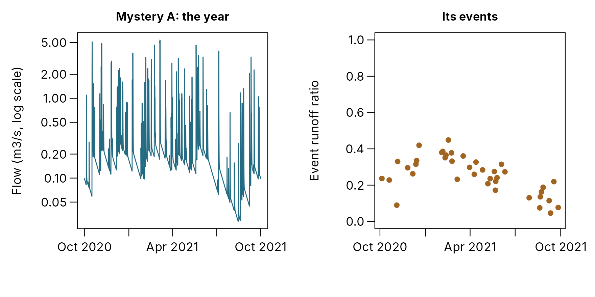
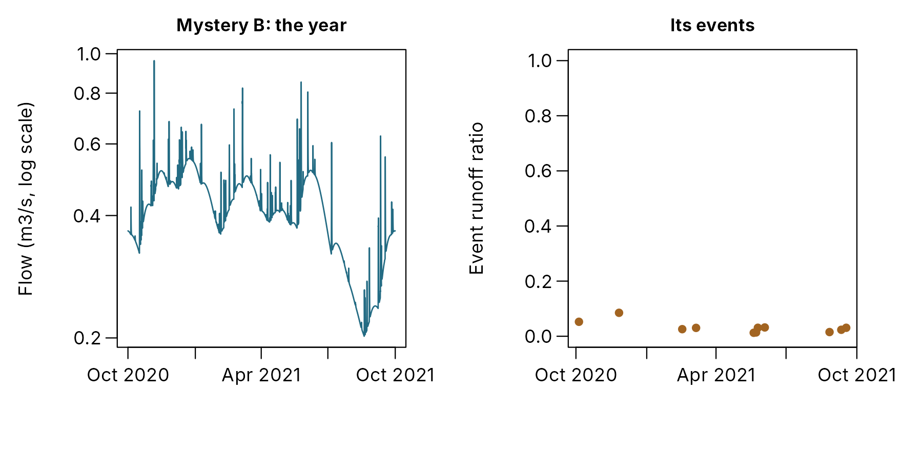
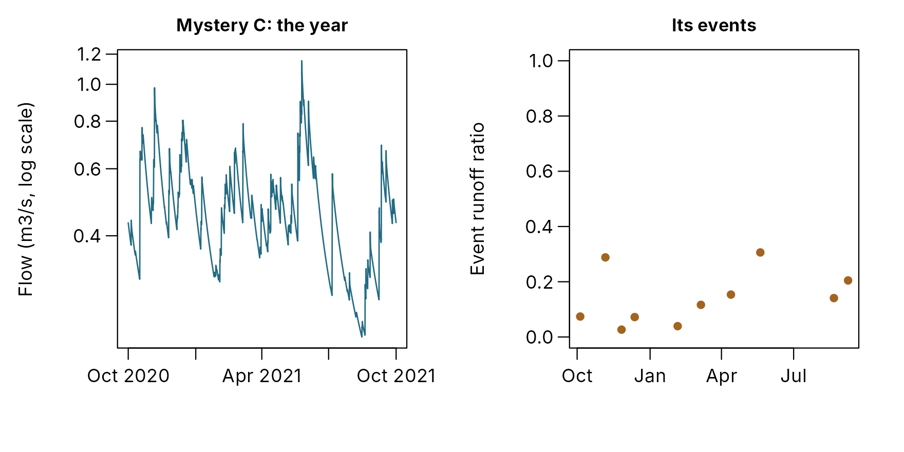

# Reading the response: what each model option does to the flow

A PDM is three choices stacked on each other: how the soil store fills
and sheds water, how water reaches groundwater, and how groundwater
drains to the river. Each choice leaves its own mark on the hydrograph.
This article shows those marks, one component at a time, with everything
else held fixed, so you can learn to read a river’s record and know
which part of the model it is pointing at.

It is written for training. Each section explains how the option works,
compares the options on the same storms, and ends with **what to look
for** in an observed record. The last section gathers these into a
single table. The equations are in [Model
equations](https://jonpayneea.github.io/PDMS7/articles/model-equations.md),
and the configuration options in [Choosing model
components](https://jonpayneea.github.io/PDMS7/articles/model-options.md).


The three choices this article compares, in the order water meets them.

All the runs below use the same rain: 5 storms over 40 days, at an
hourly step. The first, 10 mm, falls on a dry catchment. Then come 20
mm, two 30 mm storms two days apart, and 15 mm, as the catchment wets
up. Potential evaporation is a steady 0.08 mm/h.

## 1. The soil store: how capacity is spread

### How it works

The PDM pictures the catchment as many small stores of different
capacities, side by side. Rain fills them all to the same depth, the
*critical capacity*. Any store whose capacity is below that depth is
full, and every further drop of rain on it runs off. So the share of the
catchment producing runoff is the share of stores already full, and it
grows as the catchment wets up. The **capacity distribution** says how
capacities are spread across the catchment, and so how fast that
contributing area grows.


Twenty stores drawn from each distribution, all with a mean capacity of
150 mm, filled to the same critical depth of 120 mm (dotted). Blue:
water in stores not yet full. Orange: full stores, which shed any
further rain as runoff. Tall outlines are cut off at the top of the
panel.

All five distributions hold the same water when full: 150 mm on average.
They differ in the spread:

- **Pareto** (the usual choice) has many shallow stores and few deep
  ones, up to a largest capacity, `cmax`. Its exponent `b` sets the
  spread: 0 means every store is the same size; larger values mean more
  shallow stores.
- **Rectangular** spreads capacities evenly from `cmin` to `cmax`.
- **Triangular** has most stores near the middle, with few very shallow
  or very deep.
- **Exponential** and **lognormal** have no largest store, and many very
  shallow ones, so part of the catchment runs off from the first rain.

### What it does to quick flow


Quick flow from one storm on the dry catchment (left, 10 mm on day 2)
and one in the wet spell (right, 30 mm on day 15), each model starting
with its soil 30 per cent full. Note the different scales.

The labels give each model’s peak. On the dry catchment, the exponential
and lognormal stores give a clear response and the triangular almost
none. By the wet spell every model responds strongly, and the gap
between them has narrowed.


Left: quick flow added up over the 40 days. Right: the share of the
catchment producing runoff.


The share of each storm’s rain that became direct runoff.

The same storms, the same starting water, the same routing: only the
spread of capacities differs, yet the quick flow differs a lot.

- **The unbounded families respond most throughout.** Exponential and
  lognormal have many very shallow stores, so even the first small storm
  on a dry catchment runs off from about 30 per cent of it.
- **The bounded families depend most on wetness.** Their runoff ratio
  climbs steeply through the wet spell: the triangular distribution’s
  rises six-fold from the first storm to the last, the exponential’s
  less than two-fold. With few shallow stores, they shed little until
  the catchment has wetted up.

The panel below shows the same thing across the whole range of wetness.
At any given soil storage, the unbounded families shed more, and their
share rises roughly in step with the storage. The bounded families shed
little until the store is well filled, then rise steeply towards
shedding everything as it nears full: a threshold-like response. The
Pareto’s `b` sets how sharp that threshold is.


The share of 10 mm of rain that runs off at once, against how full the
soil store is.

### A year of storms, as an event table sees it

The short sequence shows the idea; a year of rain shows it as you would
see it in a real record. Each point below is one event found by
[`find_events()`](https://jonpayneea.github.io/PDMS7/reference/find_events.md)
in a year of simulated flow, placed by how wet the soil was when its
rain began and how much of the rain came back as quick flow.


Every event of at least 5 mm in a year: its runoff ratio against the
soil store’s fill when its rain began. Lines: the median in bands of
soil fill.

In an observed record you can draw the same plot with the event table
and a proxy for wetness, such as the baseflow at the start of each
event. A cloud that sits near zero until the soil is half full, then
climbs, points to a threshold-like store: Pareto with a small `b`, or
triangular. One that gives a clear ratio even from dry soil points to
the exponential or lognormal store, whose shallow stores fill first.

### The same water, different floods

A calibration that fits the total volume can still get the floods wrong.
Below, each distribution’s capacities are scaled so that all five give
exactly the same quick flow over the year as the Pareto store. Their
floods still differ.


The six largest floods of the year, with every distribution scaled to
give the same total quick flow. Each line is one distribution; the
storms are in date order.

With the same year’s quick flow, the flood peaks still differ by up to
35 per cent between distributions, in a pattern that changes from storm
to storm with how wet the catchment was. The scaling needed was large:
the exponential store’s mean capacity had to change by a factor of 3.80
to match. Volume alone cannot choose the distribution; the floods can.

> **What to look for.** Compare the runoff ratios of similar storms in
> dry and wet conditions, using
> [`find_events()`](https://jonpayneea.github.io/PDMS7/reference/find_events.md)
> and the event table. Small dry-weather storms giving a clear response,
> and a ratio that rises steadily with wetness, point to many shallow
> stores: a larger Pareto `b`, or the exponential or lognormal
> distribution. Little response until the catchment is wet, then a sharp
> rise, points to a threshold-like store: a smaller Pareto `b`, or the
> triangular distribution.

## 2. Recharge: how water reaches groundwater

### How it works

Recharge decides how much water goes to the slow groundwater route
rather than the quick surface route, and when.

- **Standard** recharge drains the soil store downward, at a rate that
  grows with how full it is: `d = (S - St)^bg / kg`. Recharge goes on
  between storms, as long as the soil holds water above the tension
  threshold `St`.
- **Split** recharge takes nothing from the soil store. A fixed share,
  `1 - alpha`, of each storm’s direct runoff goes to groundwater, and
  the rest to the surface. Recharge happens only while it is running
  off.
- **Demand** recharge drains the soil according to how much room the
  groundwater store has: fast when groundwater is low, slowing as it
  fills.


Where each rule takes groundwater recharge from.


Left: recharge to groundwater added up over the 40 days; grey bands mark
the storms. Right: the baseflow it produces. Every model starts in
steady state at the same flow.

In the cumulative plot, a line that climbs only in steps, at the storms,
is recharge from runoff; a line that keeps climbing between storms is
drainage from the soil.

| rule     | evaporation_mm | quick_flow_mm | slow_flow_mm | slow_share |
|:---------|---------------:|--------------:|-------------:|-----------:|
| Standard |             12 |             6 |           79 |       0.93 |
| Split    |             55 |            16 |           19 |       0.55 |
| Demand   |              2 |             2 |          105 |       0.98 |

Over the 40 days and 105 mm of rain: where the water went, and the slow
route’s share of the river’s flow.

- **Standard** recharge carries on after each storm, draining the soil
  for days, so baseflow rises slowly, peaks after the rain has stopped
  and falls slowly. Most of the water reaches the river by the slow
  route.
- **Split** recharge comes in pulses, only while the catchment runs off.
  Baseflow jumps with each storm and recedes at once. Nothing drains
  from the soil between storms, so more of the rain is held there and
  evaporates, and the slow route carries about half the flow.
- **Demand** recharge drains the soil hard while groundwater has room:
  bursts during each storm, then a steady rate of up to `qsat` between
  them. Baseflow is held high and flat, then collapses once the soil can
  no longer supply it. Little water stays in the soil long enough to
  evaporate.

The amounts depend on the parameter values chosen here; the shapes are
what each rule gives.

### Through a year: low flows and the seasons

Forty days of storms cannot show how each rule carries the river through
summer. A year can.


Left: flow duration curves over the year, every flow ranked from highest
to lowest, on a log scale; dotted lines mark Q70 and Q95. Right: the
baseflow index by month, the slow route’s share of each month’s flow.

The rules part company at the low-flow end of the duration curve, where
the river is fed only by groundwater. Q95, the flow exceeded 95 per cent
of the time, is 0.149 m3/s with standard recharge, 0.017 with split and
0.048 with demand. Standard recharge keeps groundwater fed from the soil
into summer; split recharge starves it once storms stop running off.
Demand recharge gives the highest flows for most of the year but falls
away in late summer, once the soil it draws on is dry.

The monthly baseflow index tells the rules apart at once, but hardly
changes with the season: about half the flow under split recharge, more
than nine-tenths under standard, nearly all under demand. Each rule
fixes the share; the season sets only how much water there is to share.

> **What to look for.** Watch how baseflow behaves after a storm.
> Baseflow that keeps rising for days after the rain has stopped, then
> falls slowly, is soil drainage: standard recharge. Baseflow that steps
> up during each storm and starts falling at once points to split
> recharge. Baseflow held high and flat through a wet spell, then
> dropping away, points to demand recharge. The baseflow index, from
> [`water_balance()`](https://jonpayneea.github.io/PDMS7/reference/water_balance.md),
> says how large the slow route must be.

## 3. The groundwater store: how it drains

### How it works

The groundwater store turns recharge into baseflow through a
storage-outflow relationship. In a **linear** store the outflow is
proportional to the storage, `q = S / kb`. In **quadratic** and
**cubic** stores it rises with the square or the cube of the storage,
`q = S^m / kb`, so a full store drains fast and a nearly empty one very
slowly. In the **exponential** store, outflow grows exponentially with
storage, giving the slowest tail of all.

To compare them fairly, every store below starts draining at the same
rate, 0.01 mm/h, takes the same steady input, 0.1 mm/h, and holds the
same 60 mm more water at its equilibrium than at the start. They differ
only in how outflow depends on storage in between.


The same input to every store: 0.1 mm/h for 60 days, starting from an
outflow of 0.01 mm/h, then nothing for 60 days. Left: outflow. Right:
each store’s outflow as a share of the linear store’s, which shows where
they differ.

Given the same water to fill, the four stores behave much alike: the
store’s form changes the shape of the response, not its size. The
right-hand panel shows where they differ:

- **Filling.** The nonlinear stores lag at first, giving 25 to 40 per
  cent less outflow than the linear store in the first weeks, then catch
  up and overtake it as they near the input rate: an S-shaped rise,
  against the linear store’s steady approach.
- **Draining.** When input stops, the nonlinear stores fall faster at
  first, then flatten. After about 40 days they give more flow than the
  linear store, and the gap keeps growing: the long tail that the next
  section explains.

### Recession curves: the store’s fingerprint

#### What a recession curve is

After rain stops and the quick flow has passed, the river is fed only by
the groundwater store draining. That falling limb is the **recession**.
How fast the flow falls depends on how much water is left, and the form
of the store sets that relationship. A recession curve measures it: for
every point on a recession, the **rate of fall** (how many mm/h the flow
drops per hour, `-dQ/dt`) against the **flow** at that moment (`Q`).


From hydrograph to recession curve. Left: a recession, with the slope of
the hydrograph (the rate of fall) marked at three points. Right: the
same three points as rate of fall against flow, on log scales. Every
point of every recession goes on the right-hand plot.

Early in the recession (A) the flow is high and falls fast; later (B, C)
it is lower and falls more slowly. On log scales, the points line up
along a straight line. That line is the recession curve.

#### How to read it

- **The slope is the store’s form.** The steeper the line, the more the
  rate of fall slows as the flow drops. A linear store gives a slope of
  1: the flow always loses the same share of itself per day, so it
  halves in the same time whatever its level. Nonlinear stores give
  steeper slopes, 1.5 for the quadratic, 5/3 for the cubic and 2 for the
  exponential: the lower the flow, the longer it takes to halve, and the
  recession tails off.
- **The height is the store’s size.** At a given flow, a line higher up
  means a faster fall: a smaller or quicker store. Flow divided by its
  rate of fall is the store’s response time at that flow, in hours. For
  a linear store it is the same at every flow; for a nonlinear store it
  grows as the flow falls.

The difference between the stores is clearest if they start alike.
Below, all four start at the same flow, 0.1 mm/h, falling at the same
rate (a response time of 500 hours), and drain with no more input.


Four stores starting at the same flow and the same rate of fall,
draining for 120 days. Left: the recessions on a log scale. Right: their
recession curves, with the slopes the store forms predict (dashed).

From the same start, after 120 days the linear store is down to 0.0003
mm/h, while the cubic still gives 0.0094 mm/h and the exponential 0.0148
mm/h: thirty to fifty times more. That is the difference between a river
that dries to a trickle in a long summer and one that keeps flowing.

#### Halving time: the recession in days

The recession curve says the same thing in a form that is easy to
picture: **how long the flow takes to halve**, at each flow. A linear
store takes the same time whatever the flow. A nonlinear store takes
longer and longer as the flow falls.


How many days each store’s flow takes to halve, at each flow, from the
recessions above. Flow on a log scale.

All four start at about 14 days to halve. The linear store stays there.
By the end of its recession the cubic store takes 70 days and the
exponential 98. Staff can read halving times straight off a log-scale
hydrograph: a recession that halves every two weeks in March and every
two months in September is a nonlinear store.

#### Recessions after small and large floods

A quick test on an observed record: lay the recessions after floods of
different sizes over each other, each scaled by its starting flow. A
linear store gives the same curve every time. A nonlinear store falls
faster, at first, after a large flood than after a small one.


Recessions from three starting flows, each divided by its starting flow.
Left: the linear store, whose recessions coincide. Right: the cubic
store, whose recession after the largest flood falls fastest.

#### Recession curves from a real river

[`recession_analysis()`](https://jonpayneea.github.io/PDMS7/reference/recession_analysis.md)
builds the recession curve from an observed record, and
[`plot_recession()`](https://jonpayneea.github.io/PDMS7/reference/plot_recession.md)
draws it with a fitted model’s alongside:

``` r
rec <- recession_analysis(flow, rain, dt = 0.25, time = time, months = c(11:12, 1:3))
rec
plot(rec)
```

A real record is noisier than these curves, and five things shape it:

1.  **Only true recessions count.** Points where rain fell, or soon
    after it while the quick flow is still passing, are not the
    groundwater store draining. The function uses only falling flow,
    some time after the last rain (three response times by default).
2.  **Average the flow first.** At 15-minute steps the rate of fall is
    mostly noise; the function averages to daily flow by default.
3.  **Recharge between storms flattens the slope.** With standard
    recharge, the soil keeps feeding groundwater through a recession, so
    the flow falls more slowly than the store alone would make it, and
    the slope reads low. On made-up catchments the slope read 0.1 to 0.9
    too low. Read the store’s form straight from the slope only where
    recharge stops between storms.
4.  **Evaporation steepens summer recessions.** Winter recessions,
    `months = c(11:12, 1:3)` above, show the store more cleanly.
5.  **The slope is a check, not the choice.** In a benchmark of sixteen
    made-up catchments, the slope found the true store in eight. Use it
    to check that a fitted model’s low flows fall at the right rate, and
    let the structure comparison choose the store.

> **What to look for.** Plot the winter dry-weather recessions on a log
> scale. A straight line, the flow halving in the same number of days
> whatever its level, points to a linear store. A recession that falls
> fast from high flow and then flattens into a long tail points to a
> nonlinear store: cubic for most UK catchments with groundwater,
> exponential if the tail barely falls through a long dry spell.
> [`plot_recession()`](https://jonpayneea.github.io/PDMS7/reference/plot_recession.md)
> then shows whether the fitted model’s recessions match the river’s.

## Fingerprints

The same measures for every option, each changed one at a time from a
common model and run over the same year. These are measures you can take
from an observed record, so the table is a guide to which option a river
resembles.

| component   | option      | annual_flow_mm | peak_m3s | baseflow_index | q95_over_q50 | dry_halving_days |
|:------------|:------------|---------------:|---------:|---------------:|-------------:|-----------------:|
| Soil store  | Pareto      |            653 |     1.92 |           0.93 |         0.56 |             61.3 |
| Soil store  | Rectangular |            657 |     2.79 |           0.88 |         0.57 |             63.3 |
| Soil store  | Triangular  |            650 |     1.30 |           0.97 |         0.56 |             59.6 |
| Soil store  | Exponential |            664 |     4.32 |           0.80 |         0.58 |             67.5 |
| Soil store  | Lognormal   |            661 |     4.20 |           0.84 |         0.58 |             66.9 |
| Recharge    | Standard    |            653 |     1.92 |           0.93 |         0.56 |             61.3 |
| Recharge    | Split       |            357 |     4.77 |           0.50 |         0.44 |             42.0 |
| Recharge    | Demand      |            744 |     1.04 |           1.00 |         0.56 |             16.9 |
| Groundwater | Linear      |            653 |     1.94 |           0.93 |         0.49 |             52.8 |
| Groundwater | Quadratic   |            653 |     1.92 |           0.93 |         0.54 |             58.7 |
| Groundwater | Cubic       |            653 |     1.92 |           0.93 |         0.56 |             61.3 |
| Groundwater | Exponential |            653 |     1.91 |           0.93 |         0.59 |             68.0 |

One option changed at a time from a common model (Pareto soil store,
standard recharge, cubic groundwater store), over the same year. Q95/Q50
is the low-flow index: higher means better-sustained low flows. Dry
halving time is the median days to halve on falling days after four dry
days.

Read the table by column. The soil store options differ most in the
peak; the recharge rules in the baseflow index and the low-flow index;
the groundwater stores in the low-flow index and the dry-weather halving
time. That is where to look in a record for each choice.

The recharge rules also change the annual flow, from 357 mm with split
recharge to 744 mm with demand. Water left in the soil store evaporates;
water sent on to groundwater does not. So the rule decides the water
balance as well as the shape of the hydrograph, and a model that runs
short of water year after year may have the wrong rule rather than the
wrong rain.

## Putting it together

The table gathers what to look for, and how to represent it.

| What you see in the record                                          | What it points to                          | How to represent it                                                                                |
|---------------------------------------------------------------------|--------------------------------------------|----------------------------------------------------------------------------------------------------|
| Small storms on a dry catchment give a clear response               | many shallow stores                        | larger Pareto `b`, or the exponential distribution                                                 |
| Little response until the catchment is wet, then most rain runs off | a threshold-like store                     | smaller Pareto `b`, or triangular                                                                  |
| The runoff ratio rises steadily with wetness                        | capacities spread widely                   | exponential or lognormal distribution                                                              |
| Baseflow keeps rising for days after rain stops                     | soil drainage to groundwater               | standard recharge, with `kg` setting the pace                                                      |
| Baseflow steps up during storms and falls at once                   | recharge from runoff only                  | split recharge, with `alpha` the surface share                                                     |
| Baseflow held high and flat through a wet spell, then dropping away | recharge driven by groundwater room        | demand recharge                                                                                    |
| Recessions are straight lines on a log scale                        | a linear store                             | linear groundwater store                                                                           |
| Recessions fall fast, then flatten into a long tail                 | a nonlinear store                          | cubic store (or quadratic)                                                                         |
| A tail that barely falls through a dry summer                       | a very slow, deep store                    | exponential store                                                                                  |
| Tiny event runoff ratios, yet a large and steady river              | water reaching the river by the slow route | standard recharge from a threshold-like soil store                                                 |
| Each storm lifts the whole flow, with little separate spike         | recharge almost as fast as runoff          | demand recharge                                                                                    |
| The model runs short of water year after year, with good shapes     | water left in the soil and evaporated      | a recharge rule that sends more water on, once the rain and the area are checked                   |
| A sharp spike on top of a slower flood hydrograph                   | two quick timescales                       | a two-zone model ([The two-zone PDM](https://jonpayneea.github.io/PDMS7/articles/two-zone-pdm.md)) |

Three cautions:

1.  **The options trade off.** A larger `cmax` and a smaller `b` can
    give similar runoff, and so can several recharge settings. Look at
    the record to decide which family is plausible, and let calibration
    choose within it.
2.  **Check the data before the structure.** Flow higher than the rain
    can explain, or a storm the river barely felt, is more often a data
    problem than a missing component. See [Checking the data and the
    events](https://jonpayneea.github.io/PDMS7/articles/checks.md).
3.  **The structure recommendation does this comparison for you,** on
    validation data, and the report shows why it chose each component.
    Use this article to judge whether its choice makes sense for the
    river you know. See [How the model structure is
    chosen](https://jonpayneea.github.io/PDMS7/articles/choosing-structure.md).

## Exercises: mystery hydrographs

Each record below was made by a model with one option from each
component. The options are not named. Use the clues in this article to
work out which, then open the answer.

**Mystery A**



1.  Do small storms on a dry catchment give a response?
2.  After a storm, does baseflow keep rising, or fall at once?
3.  On the log scale, are the dry-weather recessions straight or curved?

Answer A

An **exponential** soil store, **split** recharge and a **linear**
groundwater store. Every event returns a share of its rain, even in a
dry summer: many shallow stores. The flow drops back after each storm
with no slow rise between them: recharge only from runoff. The
recessions are straight on the log scale, halving in the same time at
any level: a linear store.

**Mystery B**



1.  How much of each storm’s rain comes back as quick flow?
2.  Yet how large is the flow, and what shape does it take through the
    year?

Answer B

A **Pareto store with a small `b`** (0.1), **standard** recharge and a
**cubic** groundwater store. Storms return almost nothing as quick flow,
in winter as in summer: a threshold-like store that sheds little until
it is nearly full, and standard recharge drains it before it fills. Yet
the river is never low. The water reaches it by the slow route, so the
flow swells and shrinks in smooth arcs over weeks: soil drainage into a
nonlinear store. A chalk or sandstone river looks like this.

**Mystery C**



1.  Does each storm give a sharp spike, or lift the whole flow?
2.  Compare how fast the flow falls after a rise with how fast it falls
    in late summer.

Answer C

A **rectangular** soil store, **demand** recharge and an **exponential**
groundwater store. Each storm lifts the whole flow, with little of a
separate spike: demand recharge pulls water from the soil whenever
groundwater has room, so it reaches the river by the slow route almost
as fast as runoff. Few storms count as events, and their ratios are low
and scattered. A high rise halves in two or three weeks; the late-summer
recession, from a lower flow, takes about twice as long: an exponential
store, quicker when full and slower when low.
