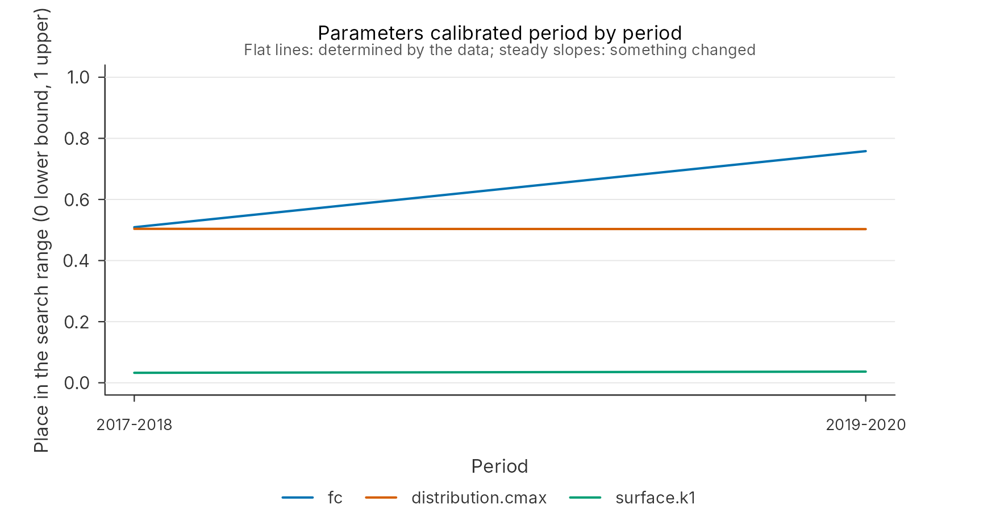

# Will the calibration hold? Stress tests

A calibration describes the years it was fitted to. The model will be
used in other years: wetter, drier, after the gauge has been changed or
the land drained. Two tests show whether a calibration will hold:
calibrate on one kind of year and score another, and calibrate period by
period and watch the parameters.

## The catchment

The synthetic catchment of [Counting every error
fairly](https://jonpayneea.github.io/PDMS7/articles/fair-errors.md),
over four years.

``` r
rain <- synthetic_rain("2016-10-01", years = 4, dt = 1, seed = 5)
truth <- modifyList(pdm_presets("standard"), list(area_km2 = 25))
model <- pdm_from_config(truth)
forcing <- rain[c("time", "rain", "pet")]
set.seed(8)
flow <- run_pdm(model, forcing[c("rain", "pet")], initial_state(model, 0.5))$output$q_m3s
observed <- flow * exp(rnorm(length(flow), 0, 0.15))
start <- modifyList(truth, list(fc = 0.8))
lower <- c(fc = 0.6, distribution.cmax = 100, surface.k1 = 1)
upper <- c(fc = 1.4, distribution.cmax = 500, surface.k1 = 30)
```

## Dry years against wet years

The differential split-sample test (Klemeš, 1986) sorts the complete
water years by rain, calibrates on the drier half and scores the wetter
half, then the reverse. A model fit for the floods of a wetter future
should keep its score when it moves from dry years to wet; a large drop
means the calibration leans on conditions it will not always meet.

``` r
sst <- split_sample_test(start, forcing, observed, lower, upper, objective = "boxcox",
                         start = "soil", control = list(maxit = 40))
sst$years
#> $dry
#> [1] 2019 2020
#> 
#> $wet
#> [1] 2017 2018
sst$scores[, c("calibrated_on", "scored_on", "nse", "boxcox_nse", "volume_error")]
#>   calibrated_on scored_on       nse boxcox_nse volume_error
#> 1           dry       dry 0.9679109  0.9706972 0.0052968353
#> 2           dry       wet 0.9693745  0.9735671 0.0098805829
#> 3           wet       dry 0.9677370  0.9706252 0.0009787743
#> 4           wet       wet 0.9697640  0.9736343 0.0056755582
sst$parameters
#>   calibrated_on       fc distribution.cmax surface.k1
#> 1           dry 1.002721          301.5395   2.010604
#> 2           wet 1.006172          301.7608   1.958977
```

Each calibration is scored twice, on its own years and on the others.
Read the drop from its own years to the others, in both directions. Here
the model is right by construction, so the scores barely move. On a real
record a common failure is the volume: a calibration on dry years may
let the soil store swallow too much rain, and the volume error then
grows in the wet years.

`split = "halves"` uses the first and second halves of the record
instead: the classic split sample, which tests change over time rather
than climate.

## Parameters period by period

[`parameter_drift()`](https://jonpayneea.github.io/PDMS7/reference/split_sample_test.md)
cuts the record into runs of consecutive water years and calibrates each
on its own. Parameters the data determine stay put; a steady drift
points to a change in the catchment or the record that one long
calibration would average away.

To show it working, a record in which something changes halfway: the
rainfall factor `fc` goes from 1.0 to 1.2 in October 2018, as it might
if a rain gauge were replaced by one that catches more.

``` r
changed <- pdm_from_config(modifyList(truth, list(fc = 1.2)))
s0 <- initial_state(model, 0.5)
early <- run_pdm(model, forcing[c("rain", "pet")], s0)$output$q_m3s
late <- run_pdm(changed, forcing[c("rain", "pet")], s0)$output$q_m3s
cut_at <- which(forcing$time >= as.POSIXct("2018-10-01", tz = "UTC"))[1]
shifted <- c(early[seq_len(cut_at - 1)], late[seq.int(cut_at, length(late))]) *
  exp(rnorm(length(late), 0, 0.15))
drift <- parameter_drift(start, forcing, shifted, lower, upper, periods = 2,
                         objective = "boxcox", start = "soil", control = list(maxit = 40))
drift
#> Parameters calibrated period by period
#>  period from   to    fc distribution.cmax surface.k1
#>       1 2017 2018 1.007             301.5      1.947
#>       2 2019 2020 1.206             301.2      2.059
#> Change from the first period, as a share of each parameter's range
#>  period from   to   fc distribution.cmax surface.k1
#>       1 2017 2018 0.00           0.00000     0.0000
#>       2 2019 2020 0.25          -0.00091     0.0039
plot(drift)
```



`fc` moves from 1.01 to 1.21, a quarter of its search range, between the
two periods, and the others stay put: the test finds the change and says
which parameter absorbed it. On a real record this is how a change of
rain gauge, of rating or of land use shows up: a tipping-bucket gauge
replaced by a weighing gauge that catches more rain, for example,
appears as a step in `fc`. With three or more periods a steady slope
separates a real trend from noise.

## What to do with the answer

- **A drop from dry to wet**: calibrate on a record that includes wet
  years, weight the floods with an event or threshold objective, or
  choose the model on forecasts in wet years ([Choosing a model as a
  forecaster](https://jonpayneea.github.io/PDMS7/articles/forecast-choice.md)).
- **Drift in one parameter**: find what changed. If the change is in the
  record, such as a new gauge, calibrate on the years since. If it is in
  the catchment, the recent years describe the catchment that will be
  forecast.
- **Drift in every parameter**: the parameters are poorly determined
  ([Which parameters can the record
  determine?](https://jonpayneea.github.io/PDMS7/articles/global-sensitivity.md));
  fix the weak ones and test again.

## Cautions

- **Each half must hold floods.** A test whose wet half has no large
  flood says little about floods.
- **The tests cost a calibration each**, two for the split sample and
  one a period for the drift. The faster stages of
  [`pdm_stages()`](https://jonpayneea.github.io/PDMS7/reference/pdm_stages.md)
  (`method = "dds"`, `coarse_dt`) help on long 15-minute records.
