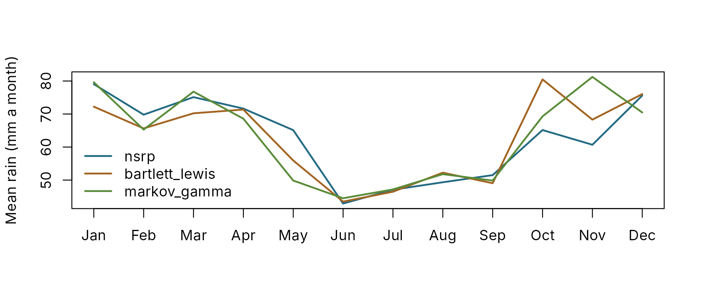
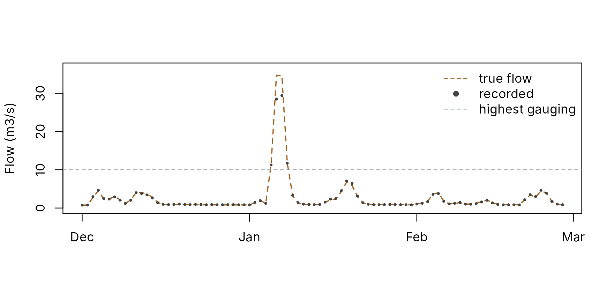

# Synthetic rivers: try everything on a known answer

A synthetic river is a calibration problem whose answer is known. Rain
from a stochastic generator drives a PDM with chosen parameters, and a
simulated gauge records the flow with the faults real gauges have.
Calibrate to it and you can see, parameter by parameter, what a method
recovers and what it cannot. It needs no data, so it is also the
quickest way to try the whole package.

Two functions do the work:

- [`synthetic_rain()`](https://jonpayneea.github.io/PDMS7/reference/synthetic_rain.md)
  generates rain and potential evaporation at any step from 15 minutes
  to a day, by one of four methods, from built-in parameters or
  parameters fitted to a real gauge.
- [`synthetic_catchment()`](https://jonpayneea.github.io/PDMS7/reference/synthetic_catchment.md)
  drives the PDM with that rain and adds storms, gauge error and an
  extrapolated rating.

## Rain

### Four generators

| Method           | How it makes rain                                                                                                               | Steps        | Best for                                      |
|------------------|---------------------------------------------------------------------------------------------------------------------------------|--------------|-----------------------------------------------|
| `nsrp` (default) | Neyman-Scott rectangular pulses: storms arrive at random, each spawning rain cells with their own delay, duration and intensity | Any          | Sub-daily rain with realistic storms          |
| `bartlett_lewis` | Bartlett-Lewis rectangular pulses: a storm produces cells at a steady rate until it stops                                       | Any          | The same, by the other classic model          |
| `markov_gamma`   | Wet and dry days from a Markov chain, amounts from a gamma distribution                                                         | Daily        | Simple daily rain                             |
| `resample`       | Blocks of whole days drawn from a real record, from the same time of year                                                       | The record’s | Rain exactly like the gauge’s, in a new order |

All four change with the seasons: their parameters are set month by
month. The built-in parameters are illustrative, chosen to resemble
lowland England (about 760 mm a year, gentle frontal rain in winter,
short intense storms in summer), and fitted to no particular site. All
three parametric generators describe the same climate.

``` r
gen <- function(method, dt) {
  synthetic_rain("2000-10-01", years = 30, dt = dt, method = method, seed = 1)
}
daily <- list(nsrp = gen("nsrp", 24), bartlett_lewis = gen("bartlett_lewis", 24),
              markov_gamma = gen("markov_gamma", 24))
summary_of <- function(r) {
  wet <- r$rain > 0.1
  c(mm_per_year = sum(r$rain) / 30, wet_days = mean(wet), mean_wet_day_mm = mean(r$rain[wet]),
    wettest_day_mm = max(r$rain))
}
round(sapply(daily, summary_of), 2)
#>                   nsrp bartlett_lewis markov_gamma
#> mm_per_year     753.01         751.46       754.44
#> wet_days          0.36           0.35         0.35
#> mean_wet_day_mm   5.72           5.83         5.89
#> wettest_day_mm   92.43          91.34        44.33
```

The three agree on the totals and the share of wet days. They differ in
the extremes, which is where the models differ most: the pulse models
build heavy days from overlapping cells, the Markov chain from the tail
of one gamma distribution.

``` r
monthly <- sapply(daily, function(r) tapply(r$rain, as.POSIXlt(r$time)$mon, sum) / 30)
matplot(1:12, monthly, type = "l", lty = 1, lwd = 2, col = pal[2:4], xaxt = "n",
        xlab = "", ylab = "Mean rain (mm a month)")
axis(1, 1:12, month.abb)
legend("bottomleft", colnames(monthly), col = pal[2:4], lwd = 2, bty = "n")
```



### Statistics the pulse models reproduce exactly

For the two pulse models, the mean, variance, lag-1 autocorrelation and
proportion of dry intervals have exact formulas at any interval length.
[`rain_statistics()`](https://jonpayneea.github.io/PDMS7/reference/rain_statistics.md)
computes them, and for a record it computes the same statistics from the
data. The model’s figures and those of a 30-year simulation agree to
within the scatter of a 30-year sample:

``` r
hourly <- synthetic_rain("2000-10-01", years = 30, dt = 1, seed = 2, pet = NULL)
model <- rain_statistics(rain_parameters("nsrp"), hours = c(1, 24))
data <- rain_statistics(hourly, hours = c(1, 24))
january <- rbind(model = model[model$month == 1, -1], simulated = data[data$month == 1, -1])
round(january[order(january$hours), ], 3)
#>              hours  mean variance  lag1  pdry
#> model.1          1 0.096    0.145 0.721 0.851
#> simulated.1      1 0.092    0.138 0.706 0.858
#> model.2         24 2.304   18.178 0.154 0.450
#> simulated.13    24 2.212   17.415 0.192 0.484
```

### Fitting to a real gauge

[`fit_rain()`](https://jonpayneea.github.io/PDMS7/reference/fit_rain.md)
fits any of the three parametric generators to a record, month by month.
The pulse models are fitted by matching those statistics at 1 and 24
hours (24 and 72 hours for a daily record); the Markov chain by maximum
likelihood. A record read with reach.io can be passed straight in:

``` r
gauge <- reach.io::read_silver("data/hydrometric", "SS92F014", "P", start = "1995-01-01")
parameters <- fit_rain(gauge, "nsrp")
rain <- synthetic_rain("2030-10-01", years = 50, parameters = parameters)
# Or keep the gauge's own rain, in a new order:
rain <- synthetic_rain("2030-10-01", years = 50, method = "resample", record = gauge)
```

Without a real gauge to hand, the hourly series above stands in for one.
Fitting the Neyman-Scott model to it recovers its statistics:

``` r
fitted <- fit_rain(hourly, "nsrp")
check <- attr(fitted, "fit")
round(check[check$month %in% c(1, 7), c("month", "hours", "variance_record", "variance_model",
                                        "pdry_record", "pdry_model")], 3)
#>    month hours variance_record variance_model pdry_record pdry_model
#> 1      1     1           0.138          0.138       0.858      0.854
#> 2      1    24          17.415         17.453       0.484      0.483
#> 19     7     1           0.354          0.350       0.960      0.961
#> 20     7    24          22.546         22.905       0.748      0.744
```

Across all twelve months, the fitted variances are within 2 per cent of
the record’s and the dry proportions within 0.01. The parameters
themselves are less well determined than the statistics: several
combinations of storm rate, cells per storm and cell size give much the
same rain. That is a property of the model, not of the fit, and it does
no harm when the aim is realistic rain.

## The river

[`synthetic_catchment()`](https://jonpayneea.github.io/PDMS7/reference/synthetic_catchment.md)
takes the rain (generating it if none is given), adds any storms you
name, runs a PDM, and records the flow through a simulated gauge.

``` r
river <- synthetic_catchment(
  years = 10, dt = 24, area_km2 = 60, seed = 4,
  storms = data.frame(time = "2016-01-05", depth_mm = 150, duration_h = 48),
  error = list(sd = 0.05, memory_h = 72),
  highest_gauged_m3s = 10
)
river
#> Synthetic catchment: 3650 steps of 24 h from 2010-10-01T00:00:00Z 
#>   Rain: nsrp - 777 mm a year; 1 added storm 
#>   True flow: mean 0.906 m3/s, peak 34.7 m3/s
#>   Gauge error: sd 0.05 in logs, memory 72 h
#>   Rating: exact to 10 m3/s, then 15 per cent low at twice that; 4 steps above
```

| Part        | What it does                                                                                                                                                                                                                                                                                                                                                                                |
|-------------|---------------------------------------------------------------------------------------------------------------------------------------------------------------------------------------------------------------------------------------------------------------------------------------------------------------------------------------------------------------------------------------------|
| True model  | The standard structure with a lowland water balance: soil capacity up to 300 mm, slow drainage to groundwater above a 50 mm threshold, surface stores of 12 hours. Every calibrated parameter lies inside [`calibration_bounds()`](https://jonpayneea.github.io/PDMS7/reference/calibration_bounds.md), so a calibration can in principle recover it. Pass `truth` to use any configuration |
| Start       | Spun up over the first year, so the record starts in balance                                                                                                                                                                                                                                                                                                                                |
| Storms      | Each adds a depth over a duration, in a triangular profile. They guarantee floods larger than ten years of generated rain would give                                                                                                                                                                                                                                                        |
| Gauge error | Multiplicative and persistent: an AR(1) process in logs, here with a 5 per cent standard deviation and a three-day memory. Real gauge errors drift; they do not flicker                                                                                                                                                                                                                     |
| Rating      | Exact up to the highest gauged flow, then bent low, as an extrapolated rating often is                                                                                                                                                                                                                                                                                                      |

``` r
rows <- which(river$forcing$time >= as.POSIXct("2015-12-01", tz = "UTC"))[1:90]
time <- river$forcing$time[rows]
plot(time, river$true_flow[rows], type = "l", col = pal[3], lwd = 1.5, lty = 2, xlab = "",
     ylab = "Flow (m3/s)", ylim = c(0, max(river$true_flow[rows]) * 1.05))
points(time, river$observed[rows], pch = 16, cex = 0.5, col = pal[1])
abline(h = river$highest_gauged_m3s, lty = 2, col = pal[7])
legend("topright", c("true flow", "recorded", "highest gauging"), col = pal[c(3, 1, 7)],
       lty = c(2, NA, 2), pch = c(NA, 16, NA), bty = "n")
```



At the storm’s peak the gauge records 28 m3/s against a true 35: 18 per
cent low, mostly from the rating.

## Calibrating to it

The river drops straight into the rest of the package. Here, the
standard preset is calibrated to the first six years and checked on the
rest:

``` r
start <- pdm_presets("standard")
start$dt <- 24
start$area_km2 <- 60
bounds <- calibration_bounds(start)
f <- river$forcing
cal <- f$time < as.POSIXct("2016-10-01", tz = "UTC")
fit <- calibrate_pdm(start, f[cal, ], river$observed[cal],
                     lower = setNames(bounds$lower, bounds$path),
                     upper = setNames(bounds$upper, bounds$path),
                     log_scale = bounds$path[bounds$scale == "log"], warmup = 90,
                     objective = "nse", starts = 3, seed = 1, control = list(maxit = 40))
compare <- data.frame(
  truth = sapply(bounds$path, function(p) pdmS7:::.path_get(river$truth, p)),
  calibrated = signif(fit$parameters, 3)
)
compare
#>                     truth calibrated
#> fc                    1.0   9.66e-01
#> distribution.cmax   300.0   3.29e+02
#> distribution.b        0.4   6.30e-01
#> recharge.kg        4000.0   3.61e+03
#> surface.k1           12.0   7.28e+00
#> surface.k2           12.0   1.83e+01
#> groundwater.kb    10000.0   1.44e+05
model <- pdm_from_config(fit$config)
sim <- run_pdm(model, f[c("rain", "pet")],
               initial_state_from_flow(model, river$observed[1], 0.7))$output$q_m3s
later <- !cal
c(nse_against_recorded = pdm_scorecard(sim[later], river$observed[later])[["nse"]],
  nse_against_truth = pdm_scorecard(sim[later], river$true_flow[later])[["nse"]])
#> nse_against_recorded    nse_against_truth 
#>            0.9900075            0.9965656
```

The calibrated parameters are not the true ones: `kb` is 14 times too
large, and the two surface stores, both 12 hours in truth, come out at 7
and 18 hours. Yet the fit scores 1.00 against the truth. Many parameter
sets fit a record almost equally well; [Larger
floods](https://jonpayneea.github.io/PDMS7/articles/extrapolation.md)
shows where that matters.

Only on a synthetic river can the last line be computed: the score
against the truth, rather than against a gauge that has its own errors.

## What else to try

| Question                                 | How                                                                                                                                                                                                            |
|------------------------------------------|----------------------------------------------------------------------------------------------------------------------------------------------------------------------------------------------------------------|
| What does structural error do?           | Pass a different `truth`, such as a split recharge or an exponential store from [`structure_set()`](https://jonpayneea.github.io/PDMS7/reference/structure_set.md), and calibrate the standard structure to it |
| Does a calibration extrapolate?          | Register the river in a calibration project; the wettest years are held back and tested. See [Larger floods](https://jonpayneea.github.io/PDMS7/articles/extrapolation.md)                                     |
| How do forecasts degrade with lead time? | Use the river in a hindcast with [`pdm_hindcast()`](https://jonpayneea.github.io/PDMS7/reference/pdm_hindcast.md). See [Hindcasts](https://jonpayneea.github.io/PDMS7/articles/hindcasts.md)                   |
| What does a 15-minute record change?     | `synthetic_rain(dt = 0.25)` and a `truth` with `dt = 0.25`                                                                                                                                                     |
| How much do gauge errors matter?         | Vary `error`, `highest_gauged_m3s` and `rating_bias`, and compare the scores against the truth                                                                                                                 |

## Limits

A synthetic river flatters every method run on it. The true model is a
PDM, the rain is known exactly, and the gauge’s errors follow a simple
rule. Use it to understand methods and to test code, not to predict how
well a calibration will do on a real catchment.

## References

Cowpertwait, P.S.P. (1996) Further developments of the Neyman-Scott
clustered point process for modeling rainfall. *Water Resources
Research* 32(7), 2155-2164.

Richardson, C.W. (1981) Stochastic simulation of daily precipitation,
temperature, and solar radiation. *Water Resources Research* 17(1),
182-190.

Rodriguez-Iturbe, I., Cox, D.R. and Isham, V. (1987) Some models for
rainfall based on stochastic point processes. *Proceedings of the Royal
Society of London A* 410, 269-288.
