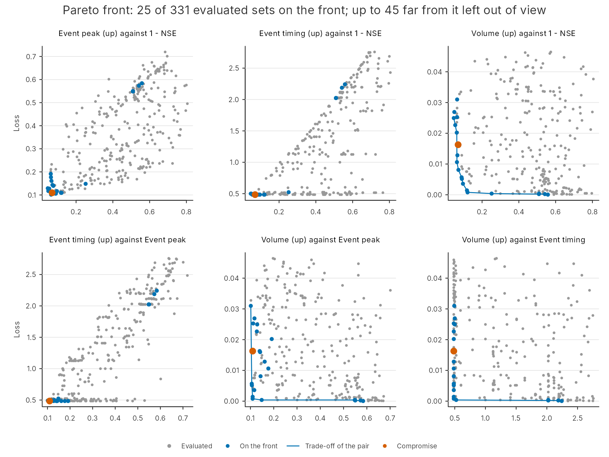
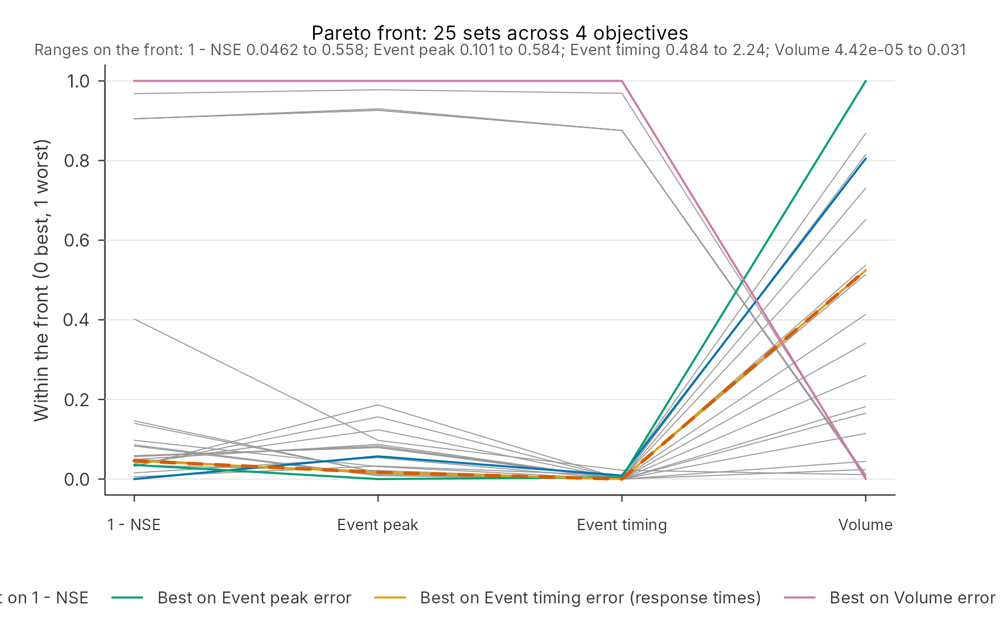
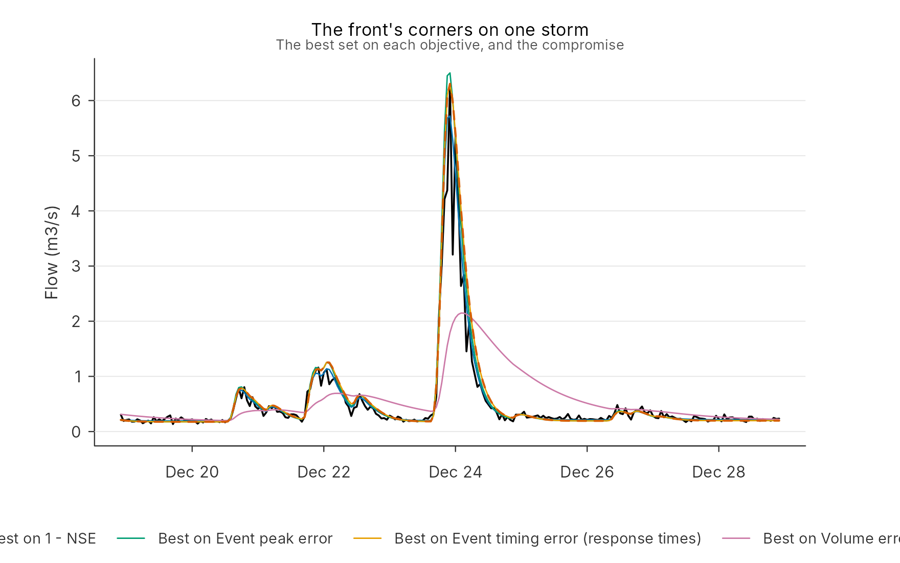
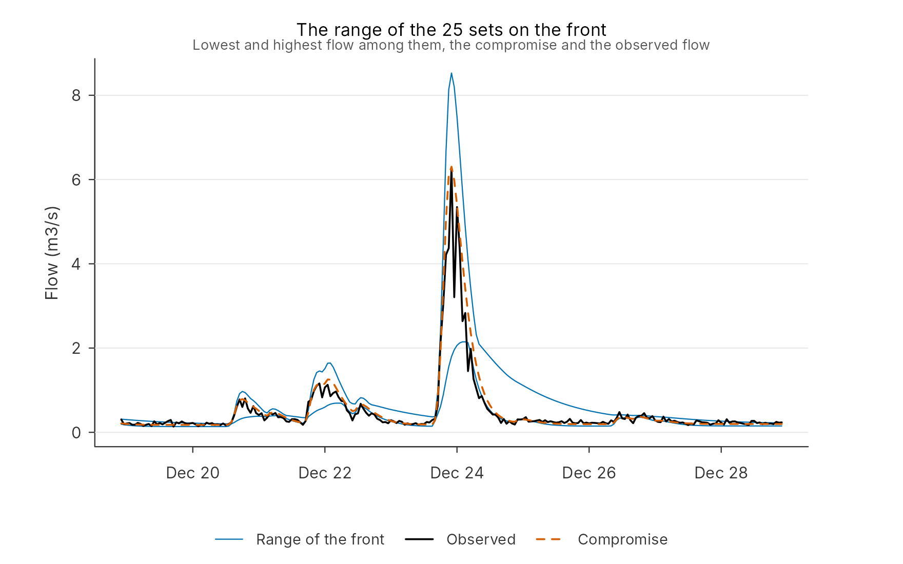
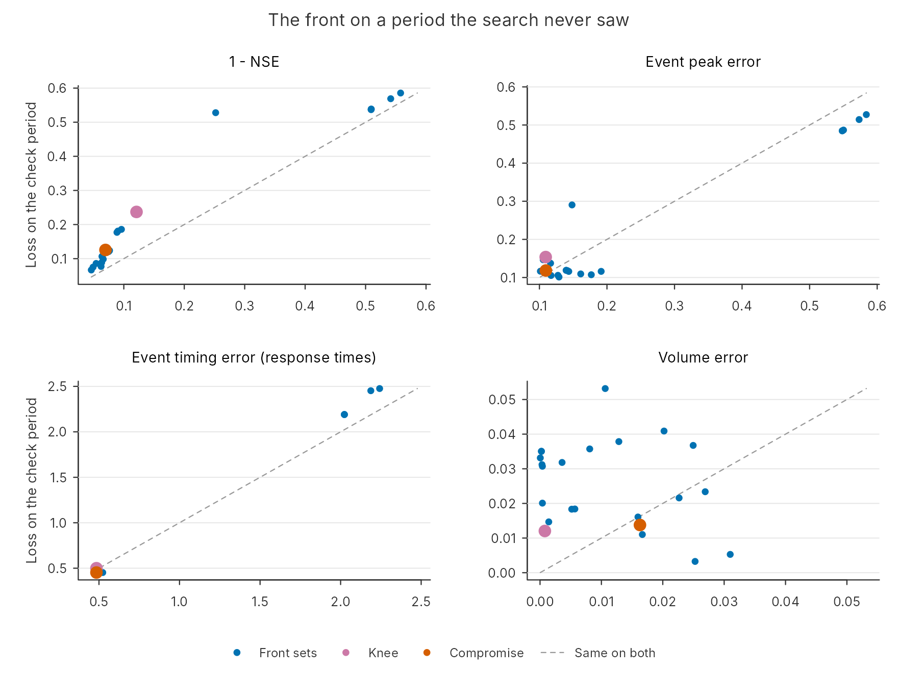

# Trade-offs: calibrating to several objectives at once

A calibration that minimises one number makes a choice it does not show.
Fit the whole record by NSE and the long recessions outweigh the floods.
Fit the floods alone and the baseflow between them drifts. Blend the two
with weights and you get one model, for one blend, with no sight of what
a different blend would have given.

A **Pareto front** shows the choice instead of making it. It is the set
of parameter sets that no other set beats on every objective at once.
Along the front, each gain on one objective costs something on another;
off it, a set is simply worse than one on it. The modeller then picks
from the front with the trade-off in view, and says why.

This article fits a front, reads it in three plots, picks a model from
it, and logs the choice.

## Calibrating on the events alone

First, the simpler question: can the PDM be calibrated on event scores
only? Yes: `objective = "events"` in
[`calibrate_pdm()`](https://jonpayneea.github.io/PDMS7/reference/calibrate_pdm.md)
scores only the windows round the floods, by pooled event NSE, peak
error and timing error. But the event windows say little about the slow
stores, recharge and the year’s volume, so a fit on events alone can get
the peaks right while the baseflow wanders. The safer use is the last
stage of a staged calibration, which refits only the fast response on
the largest events after the earlier stages have fixed the volume and
the recessions:

``` r
stages <- pdm_stages(config, events = TRUE, event_share = "0.5QMED")
fit <- calibrate_staged(config, forcing, observed, stages = stages, warmup = warmup)
```

A front goes further: it fits the events and the whole record side by
side, and shows how far they pull apart.

## A record with a known answer

A made-up catchment, so the answer is known: two years of synthetic rain
through the standard PDM, with 15% noise on the flow, as a gauge would
add. The search starts with the soil store too large and its shape and
the fast store’s time constant unknown.

``` r
rain <- synthetic_rain("2021-01-01", years = 2, dt = 1, seed = 2)
truth <- modifyList(pdm_presets("standard"), list(area_km2 = 20))
flow <- run_pdm(pdm_from_config(truth), rain[c("rain", "pet")])$output$q_m3s
set.seed(4)
observed <- flow * exp(rnorm(length(flow), 0, 0.15))
start <- truth
start$distribution$cmax <- 200
lower <- c(distribution.cmax = 80, surface.k1 = 2, distribution.b = 0.1)
upper <- c(distribution.cmax = 400, surface.k1 = 40, distribution.b = 2)
```

## Fitting the front

Four objectives, all losses to be minimised: `nse_loss` (1 - NSE, over
the whole record), `event_peak_error` and `event_timing_error` (over the
largest half of the events), and `abs_bias` (the volume error). The last
six months are held out of the search, as a check period: the front will
be scored on them later.

``` r
check <- seq.int(nrow(rain) - 24 * 182, nrow(rain))
searched <- observed
searched[check] <- NA
front <- calibrate_pdm_multi(
  start, rain[c("time", "rain", "pet")], searched, lower, upper,
  objectives = c("nse_loss", "event_peak_error", "event_timing_error", "abs_bias"),
  n_samples = 30, starts = 2, control = list(maxit = 150), warmup = 24 * 60, seed = 1
)
front
#> Pareto front: 25 of 331 evaluated parameter sets, PA-DDS, 0 failed
#> Event losses over the 64 largest of 127 events (28 screened out)
#>   nse_loss               0.04621 to 0.5579 on the front
#>   event_peak_error       0.1014 to 0.5839 on the front
#>   event_timing_error     0.4844 to 2.242 on the front
#>   abs_bias               4.417e-05 to 0.03099 on the front
```

The search starts with 30 random sets. Then two chains of
Pareto-archived dynamically dimensioned search (PA-DDS) grow the front
from them, 150 model runs each. A chain keeps the sets that no other set
it has seen beats on every objective. At each step it nudges one of
them, at first in many parameters at once and later in few, and keeps
the result if nothing beats it. It nudges sets in the sparse parts of
the front more often, so the front fills in evenly. Every set tried is
kept, and the front is drawn from all of them. It is still a sampled
front: a longer search or another seed may find a little more of it.

Each trial starts as
[`calibrate_pdm()`](https://jonpayneea.github.io/PDMS7/reference/calibrate_pdm.md)
starts it, in steady state at the first observed flow, so the front and
a single-objective calibration of the same record are comparable. With
`cores = 2` the two chains run side by side, with the same answer.

The older way, minimising weighted sums of the objectives
(`method = "dds"` and others), finds only the parts of a front that
bulge towards the origin. Where the front has a hollow, every weighting
lands on one side of it or the other, and the sets in the hollow, often
the useful middle ground, are never found. PA-DDS has no weights, so it
has no such blind spot.

## Reading the front

### Each pair

``` r
plot(front)
```



Each panel sets one objective against another. Grey points are every set
tried; blue points are on the front of all four objectives; the blue
line is the trade-off of that pair alone, and the orange point the
compromise (the best set with all four equally weighted). A front that
bends sharply means a gain on one objective costs little on the other
until the bend, and a lot after it. A flat line means no trade-off
between that pair.

### All the objectives at once

``` r
plot(front, "parallel")
```



One line per set on the front, across the four objectives, each axis
running from the front’s best (0) to its worst (1). Lines that cross
between two axes mark a trade-off; lines that run together mark
objectives that agree. The subtitle gives each axis’s real range, which
matters: an axis whose range is small magnifies a small difference.

### What the numbers mean on a storm

``` r
plot(front, "flows", forcing = rain, observed = observed)
```



The largest flood of the record, as the best set on each objective and
the compromise see it. A number like half a response time means little
until it is drawn.

### How much the choice matters

``` r
plot(front, "band", forcing = rain, observed = observed)
```



The blue lines are the lowest and highest flow among all the sets on the
front, hour by hour. Every one of those sets is defensible by some
balance of the objectives, so the width of the band is how much the
flood depends on that choice. It is a band of plausible calibrations,
not a confidence interval: it says nothing about errors in the rain or
the rating.

Here the band is wide because it includes the front’s ends: on the
largest flood one set overshoots the peak by a third and another misses
two thirds of it, each because it is the best on some objective that
does not care about peak size. Nobody would choose those sets for a
flood model. `pareto_band(front, rain, sets = ...)` gives the band of
the sets you would actually consider, such as those round the knee,
which is much narrower.

## Does the trade-off hold?

The front was fitted on the first eighteen months.
[`pareto_validate()`](https://jonpayneea.github.io/PDMS7/reference/pareto_validate.md)
scores every set on its front on the six months held out, by the same
losses.

``` r
front <- pareto_validate(front, rain, observed, check)
plot(front, "validation")
```



Each panel is one objective: a set’s loss on the calibration rows
across, on the check period up. Sets near the dashed line keep their
quality on data the search never saw; sets well above it were good on
the calibration rows only. A front whose order holds on the check period
is a front whose trade-offs are real.

Here the order holds for 1 - NSE, event peaks and event timing: sets
good on calibration stay good. It does not hold for the volume error,
which scatters: differences of a per cent or two in volume on the
calibration rows say little about the next six months. That is worth
knowing before paying for a small volume gain with anything else.

## Choosing

[`pareto_choose()`](https://jonpayneea.github.io/PDMS7/reference/pareto_choose.md)
takes one set from the front: the best on one objective, the best under
weights of your own, the knee, or the compromise.

``` r
knee <- pareto_choose(front, knee = TRUE)
knee$scores[, c("distribution.cmax", "surface.k1", "distribution.b", "loss_nse_loss",
                "loss_event_peak_error", "loss_abs_bias")]
#>    distribution.cmax surface.k1 distribution.b loss_nse_loss
#>                <num>      <num>          <num>         <num>
#> 1:          333.3256   3.136643      0.9071088     0.1210064
#>    loss_event_peak_error loss_abs_bias
#>                    <num>         <num>
#> 1:             0.1092899  0.0007876625
peaks <- pareto_choose(front, objective = "event_peak_error")
flood_weighted <- pareto_choose(front, weights = c(nse_loss = 1, event_peak_error = 2))
```

**The knee** is where the trade-off turns sharpest. Put each objective
on the front’s own scale, 0 for its best and 1 for its worst, and take
the set with the lowest total. With two objectives that is exactly the
set furthest below the straight line joining the two ends of the front.
It needs no weights, which makes it the natural rule for many catchments
at once; but it depends on which sets made the front’s ends, so look at
the plot before trusting it.

The truth is `cmax` 300 mm, `b` 0.4 and `k1` 2 h. The knee is not the
truth, and need not be: with noise on the flow and four objectives
pulling different ways, the knee is the best balance of fit, not the
best guess of the parameters. Note too that the truth’s `k1` sits on the
lower bound of the search; a value that lands on a bound may be held
there by the bound, not by the data, so widen the bounds before trusting
it.

## In a calibration project

[`log_pareto_calibration()`](https://jonpayneea.github.io/PDMS7/reference/calibration_log.md)
runs the search on the registered calibration window, from the project’s
own start, and logs the chosen set as an automatic calibration. The
entry keeps the whole front, every set’s parameters and losses, so the
report draws the front beside the chosen model and anyone reading the
log later sees the trade-off behind the choice. `check_share` cuts a
check period from the end of the calibration window; the registered
validation window is never touched, so it still judges a model chosen
without it.

``` r
log_pareto_calibration(
  project, parent = "0003", lower = lower, upper = upper,
  objectives = c("nse_loss", "event_nse_loss", "event_peak_error", "abs_bias"),
  choose = "knee", check_share = 0.25,
  reasoning = "Flood warning: see what event fit costs the whole record, take the knee"
)
```

**As a stage.** A staged calibration can end with a front instead of one
more single fit:
`pdm_stages(config, pareto = c("nse_loss", "event_nse_loss", "abs_bias"))`
adds a trade-off stage after the others. It searches only the fast
response and the time delay, with the slow stores already fixed by the
earlier stages, so a modest budget covers the front, and it keeps the
knee unless `pareto_choose` says otherwise.

**In the app.** The Trade-offs tab searches and logs a front, draws any
pair of its objectives, and shows the flow and scores of whichever set
you click, beside the logged one. If you prefer another set, keep it as
a trial and carry on from there; the log records why.

The chosen model then goes on like any other: propose it as the
candidate, validate it, and test it on the held-back years.

## Cautions

- **Scales** matter only for weights and the compromise. `scales`
  divides each loss first, so that a weight of 1 means the same on each;
  set them to a loss you would call small, such as 0.05 for a volume
  error and 0.1 for 1 - NSE. PA-DDS and the knee need none.
- **The front is a sample.** Run a second seed; if its front lies on top
  of the first, the search has covered it.
- **The front is fitted on the calibration window.** Check it on a
  period it never saw before choosing from it.
